Prepared for Sai Krishna E L

# Shopping Mall Management System

Phase 1 architecture. This document is binding for every later phase. Class names, package names, table names, column names, SQL types, enum spellings, routes, and relationships written here are the names to code. If an implementation disagrees with this file, this file wins until a later revision of this file changes it.

Checked on 23 October 2026 against the published Spring Boot 3.5.16 BOM, the MySQL 8.4.13 release notes, the Bootstrap 5.3.8 release, the Chart.js 4.6.1 release, and the Apache Maven 3.10.0 release.

## 1. Objective

Project name: Shopping Mall Management System.

Prepared for Sai Krishna E L.

Audience: a college final-year project, a portfolio piece, and a learning build.

The system is a database-driven web application. Shoppers, shop owners, and mall admins use a browser. Thymeleaf renders every page on the server from rows in MySQL. There is no static-only frontend and no separate JavaScript single-page app. JavaScript is limited to Chart.js charts, Bootstrap components, and small form helpers (confirming a cancel, previewing an image name).

A person can register as a customer or as a shop owner. An admin approves a shop owner before that owner can sign in. A customer can browse shops and products, keep a cart and a wishlist, place an order, pay with a clearly labeled simulated card payment, receive an invoice, review a delivered item, send feedback, and raise a complaint. A shop owner can maintain only their own shop, products, stock, offers, and orders. An admin can manage users, shops, catalog data, coupons, payments, staff, attendance, salaries, parking, complaints, notifications, settings, and the audit log.

Money is exact decimal arithmetic. Passwords are hashed. The database password comes from the environment. The payment screen never asks for a real card number and the database has no column for one.

## 2. Stack

| Piece | Pinned version | Why this pin |
| --- | --- | --- |
| Java | 21 | Required. Spring Boot 3.5.16 supports Java 17 through 25, so 21 is inside the tested range. |
| Spring Boot | 3.5.16 | Newest Spring Boot 3.x release on Maven Central, published 25 June 2026. It is the last 3.5 open-source patch. The 3.5 open-source line ended 30 June 2026. |
| Spring Framework | 6.2.19 | Managed by the 3.5.16 BOM. |
| Spring Security | 6.5.11 | Managed by the 3.5.16 BOM. |
| Hibernate ORM | 6.6.53.Final | Managed by the 3.5.16 BOM. |
| Hibernate Validator | 8.0.3.Final | Managed by the 3.5.16 BOM. |
| Jakarta Validation | 3.0.2 | Managed by the 3.5.16 BOM. |
| Jakarta Persistence | 3.1.0 | Managed by the 3.5.16 BOM. |
| Jakarta Servlet | 6.0.0 | Managed by the 3.5.16 BOM. |
| Thymeleaf | 3.1.5.RELEASE | Managed by the 3.5.16 BOM. |
| thymeleaf-extras-springsecurity6 | 3.1.5.RELEASE | Managed by the 3.5.16 BOM. |
| thymeleaf-layout-dialect | 3.4.0 | Managed by the 3.5.16 BOM. |
| Tomcat (embedded) | 10.1.55 | Managed by the 3.5.16 BOM. |
| HikariCP | 6.3.3 | Managed by the 3.5.16 BOM. |
| Jackson | 2.21.4 | Managed by the 3.5.16 BOM. |
| MySQL Connector/J | 9.7.0 | Managed by the 3.5.16 BOM. This driver connects to MySQL 8.4. |
| SLF4J | 2.0.18 | Managed by the 3.5.16 BOM. |
| JUnit Jupiter | 5.12.2 | Managed by the 3.5.16 BOM, brought in by `spring-boot-starter-test`. |
| Mockito | 5.17.0 | Managed by the 3.5.16 BOM. |
| AssertJ | 3.27.7 | Managed by the 3.5.16 BOM. |
| Testcontainers | 1.21.4 | Managed by the 3.5.16 BOM. Tests use image `mysql:8.4.13`. |
| Lombok | 1.18.46 | Managed by the 3.5.16 BOM. Getter and setter only. |
| Maven | 3.10.0 | Current stable Maven on 23 October 2026. Spring Boot 3.5 requires Maven 3.6.3 or newer. |
| Maven Compiler Plugin | 3.14.1 | Managed by the 3.5.16 parent. |
| Maven Surefire Plugin | 3.5.6 | Managed by the 3.5.16 parent. |
| MySQL Server | 8.4.13 LTS | MySQL 8 maintenance release dated 20 October 2026. |
| Bootstrap | 5.3.8 | Current Bootstrap 5 release, published 26 August 2025. |
| Chart.js | 4.6.1 | Current Chart.js 4 release, published 22 October 2026. |

Maven coordinates:

- `groupId`: `com.shoppingmall`
- `artifactId`: `shopping-mall`
- `version`: `0.1.0-SNAPSHOT`
- `name`: `Shopping Mall Management System`
- `packaging`: `jar`
- Parent: `org.springframework.boot:spring-boot-starter-parent:3.5.16`
- Property `java.version`: `21`

Dependencies, with versions omitted so the parent BOM supplies the versions above:

- `org.springframework.boot:spring-boot-starter-web`
- `org.springframework.boot:spring-boot-starter-thymeleaf`
- `org.springframework.boot:spring-boot-starter-data-jpa`
- `org.springframework.boot:spring-boot-starter-security`
- `org.springframework.boot:spring-boot-starter-validation`
- `org.thymeleaf.extras:thymeleaf-extras-springsecurity6`
- `nz.net.ultraq.thymeleaf:thymeleaf-layout-dialect`
- `com.mysql:mysql-connector-j` with `runtime` scope
- `org.projectlombok:lombok` with `provided` scope and `optional` true
- `org.springframework.boot:spring-boot-starter-test` with `test` scope
- `org.springframework.security:spring-security-test` with `test` scope
- `org.testcontainers:junit-jupiter` with `test` scope
- `org.testcontainers:mysql` with `test` scope

Starter coverage:

- Spring MVC comes from `spring-boot-starter-web`.
- Spring Data JPA comes from `spring-boot-starter-data-jpa`.
- Spring Security comes from `spring-boot-starter-security`.
- Bean Validation comes from `spring-boot-starter-validation`.
- Thymeleaf comes from `spring-boot-starter-thymeleaf`.
- JUnit 5, Mockito, and Spring Boot Test come from `spring-boot-starter-test`.

Money:

- Java fields that hold money or a percent used in money math are `java.math.BigDecimal`.
- MySQL columns for those values are `DECIMAL`. `FLOAT`, `DOUBLE`, and `REAL` are forbidden in this schema and in this Java project.
- Scale is 2 for money and 2 for tax percents. Rounding of money is `RoundingMode.HALF_UP` unless a rule below names a different mode.
- Chart.js receives decimal strings for display only. Charges, totals, tax, discounts, salaries, and parking fees are calculated with `BigDecimal` before they are shown.

Passwords and secrets:

- `BCryptPasswordEncoder` with strength 10. A hash is the 60-character `$2a$10$` string Spring Security writes. The column is `CHAR(60)`.
- CSRF protection stays on for form login and for every other browser POST.
- Database URL, database user, database password, and the upload directory come only from environment variables `SM_DB_URL`, `SM_DB_USER`, `SM_DB_PASSWORD`, and `SM_UPLOAD_DIR`. No properties file contains a default for those four.
- Simulated card payments are labeled on the checkout page and on the order page with the sentence `Simulated payment. Nothing is charged. This form does not ask for a card number.` The payment method value is `SIMULATED_CARD`. The schema has no column for a PAN, CVV, expiry, or cardholder name.

Frontend files are copied into the project, not loaded from a CDN:

- Bootstrap 5.3.8 `bootstrap.min.css` and `bootstrap.bundle.min.js` under `src/main/resources/static/vendor/bootstrap/`.
- Chart.js 4.6.1 `chart.umd.min.js` under `src/main/resources/static/vendor/chartjs/`.

`application.properties` (no secret defaults):

```properties
spring.application.name=shopping-mall
spring.profiles.default=dev
spring.datasource.url=${SM_DB_URL}
spring.datasource.username=${SM_DB_USER}
spring.datasource.password=${SM_DB_PASSWORD}
spring.datasource.driver-class-name=com.mysql.cj.jdbc.Driver
spring.jpa.hibernate.ddl-auto=validate
spring.jpa.open-in-view=false
spring.jpa.properties.hibernate.jdbc.time_zone=UTC
spring.jpa.hibernate.naming.physical-strategy=org.hibernate.boot.model.naming.PhysicalNamingStrategyStandardImpl
spring.thymeleaf.cache=false
server.port=8080
server.servlet.session.timeout=30m
server.servlet.session.cookie.http-only=true
server.servlet.session.cookie.same-site=lax
server.error.whitelabel.enabled=false
server.error.include-message=never
server.error.include-stacktrace=never
spring.servlet.multipart.max-file-size=2MB
spring.servlet.multipart.max-request-size=3MB
app.upload.dir=${SM_UPLOAD_DIR}
logging.level.com.shoppingmall=INFO
```

`application-dev.properties`:

```properties
server.servlet.session.cookie.secure=false
app.mail.log-reset-token=true
```

`application-prod.properties`:

```properties
server.servlet.session.cookie.secure=true
app.mail.log-reset-token=false
spring.thymeleaf.cache=true
```

Example shape of `SM_DB_URL`, with the password still outside the URL:

`jdbc:mysql://localhost:3306/shopping_mall?useSSL=false&allowPublicKeyRetrieval=true&characterEncoding=utf8&connectionTimeZone=UTC&forceConnectionTimeZoneToSession=true`

Clock and time:

- A `Clock` bean in `com.shoppingmall.config.ClockConfig` is `Clock.systemUTC()`.
- Every `LocalDateTime` stored in MySQL is UTC.
- Pages format instants in `Asia/Kolkata` with pattern `dd MMM yyyy, HH:mm` through `com.shoppingmall.util.TimeDisplay`.
- The mall currency is `INR`.

Build command for phase 3 and after: `./mvnw -B verify` using the Maven Wrapper whose `distributionUrl` points at `apache-maven-3.10.0-bin.zip`. The wrapper files are generated on a machine that already has Maven 3.10.0 by running `mvn wrapper:wrapper -Dmaven=3.10.0`.

## 3. Backend packages

Base package: `com.shoppingmall`.

| Package | Responsibility |
| --- | --- |
| `com.shoppingmall` | `ShoppingMallApplication` only. |
| `com.shoppingmall.config` | Security-adjacent Spring beans that are not the security rules, JPA auditing, clock, MVC resources, upload properties, model advice. |
| `com.shoppingmall.controller` | MVC controllers. Map a request to a form object, call one service method, choose the Thymeleaf view or redirect. |
| `com.shoppingmall.dto` | Form objects and view objects. No JPA annotations. |
| `com.shoppingmall.entity` | JPA entities. One entity class for each table. |
| `com.shoppingmall.enums` | Java enums whose names match the SQL `CHECK` values. |
| `com.shoppingmall.exception` | Domain exceptions and `GlobalExceptionHandler`. |
| `com.shoppingmall.repository` | Spring Data JPA repositories. No business rules. |
| `com.shoppingmall.service` | Service interfaces, plus `EmailNotificationPort` and `SmsNotificationPort`. |
| `com.shoppingmall.service.impl` | Service implementations and the two logging port implementations. |
| `com.shoppingmall.security` | `SecurityConfig`, user-details mapping, login handlers, ownership guard, permission matrix. |
| `com.shoppingmall.validation` | Custom Bean Validation annotations. |
| `com.shoppingmall.util` | Money split, parking charge calculator, number formatting, time display, slug helper. |

Rule: no business logic in controllers. A controller does not calculate a total, check stock, decide a status transition, query a repository, or decide ownership. Those belong in `com.shoppingmall.service.impl`. A controller may read the authenticated principal only to pass the user id into a service method. `GlobalExceptionHandler` lives in `com.shoppingmall.exception` and only chooses an error view or a field-error redirect.

Entities use `@Getter` and `@Setter`. They do not use `@Data` or `@EqualsAndHashCode`. Equality for persistence is not based on a generated hash of every field. Every persistent field has `@Column(name = "...")` and every entity has `@Table(name = "...")` using the SQL names in section 7. Repositories return entities to services only. Services return DTOs to controllers. Thymeleaf templates receive DTOs, never entities, because `spring.jpa.open-in-view=false`.

## 4. Roles and permissions

There are three roles, stored in `roles.name` and in `com.shoppingmall.enums.RoleName`:

- `ADMIN`
- `SHOP_OWNER`
- `CUSTOMER`

Granted authorities are `ROLE_ADMIN`, `ROLE_SHOP_OWNER`, and `ROLE_CUSTOMER`.

A user has exactly one role. `user_roles.user_id` is unique. Registration sets the role. The admin roles screen lists users in each role and prints the matrix below. It does not create a fourth role and it does not move a user between roles.

`users.status` is `ACTIVE`, `INACTIVE`, `PENDING`, or `REJECTED`. Login succeeds only when the password matches and `users.status` is `ACTIVE`. `INACTIVE`, `PENDING`, and `REJECTED` users cannot log in. A shop-owner row starts as `PENDING` and stays out of the application until an admin approves it.

Ownership is enforced in services through `com.shoppingmall.security.OwnershipGuard`:

- `requireCustomer(userId)` returns the `customers` row for that user or throws `ForbiddenException`.
- `requireOwner(userId)` returns the `shop_owners` row when `users.status` is `ACTIVE` and `shop_owners.approval_status` is `APPROVED`.
- `requireOwnShop(userId, shopId)` checks `shops.owner_id` equals that owner.
- `requireOwnProduct(userId, productId)` checks the product's shop.
- `requireOwnOrder(userId, orderNumber)` checks the order's shop.
- `requireOwnCoupon(userId, couponId)` allows the owner only when `coupons.scope` is `SHOP` and `coupons.shop_id` is their shop.
- `requireOwnCustomerOrder(userId, orderNumber)` checks `orders.customer_id`.
- Admin methods do not call the owner guards. They still reject a missing row with `NotFoundException`.

URL security is necessary and not sufficient. A shop owner who changes an id in the address bar receives HTTP 403 from the service, even though the URL prefix already matched `SHOP_OWNER`.

Permission matrix. "Allow" means the service method runs. "Deny" means `SecurityConfig` returns 403 before the controller when the URL prefix is wrong, and the service throws `ForbiddenException` if a forged id still reaches it.

| Action | ADMIN | SHOP_OWNER | CUSTOMER | Anonymous |
| --- | --- | --- | --- | --- |
| View home, shops, shop details, products, product details, categories, offers | Allow | Allow | Allow | Allow |
| Submit the contact form | Allow | Allow | Allow | Allow |
| Register, sign in, forgot password, reset password | Deny while already authenticated; the login page redirects home by role | Deny while already authenticated | Deny while already authenticated | Allow |
| Sign out | Allow | Allow | Allow | Deny |
| Open `/admin/**` | Allow | Deny | Deny | Deny |
| Open `/owner/**` | Deny | Allow | Deny | Deny |
| Open `/customer/**` | Deny | Deny | Allow | Deny |
| Change a user's status | Allow, except the last active admin | Deny | Deny | Deny |
| Approve or reject a shop owner | Allow | Deny | Deny | Deny |
| Create, edit, or deactivate a category | Allow | Deny | Deny | Deny |
| Edit any shop's status | Allow | Deny | Deny | Deny |
| Edit own shop profile | Allow on the admin shop screen | Allow for own shops | Deny | Deny |
| Create or edit any product | Allow | Deny | Deny | Deny |
| Create or edit a product in own shop | Allow | Allow | Deny | Deny |
| Adjust stock in own shop | Allow | Allow | Deny | Deny |
| View every order | Allow | Deny | Deny | Deny |
| View orders for own shops | Allow | Allow | Deny | Deny |
| View own customer orders | Allow | Deny | Allow | Deny |
| Move own shop order through packed, shipped, delivered | Allow | Allow when the transition in section 8 permits it | Deny | Deny |
| Cancel an order | Allow when section 8 permits admin cancel | Allow when section 8 permits owner cancel | Allow when section 8 permits customer cancel | Deny |
| Pay a pending order | Deny | Deny | Allow for own `PENDING_PAYMENT` order | Deny |
| Create a mall-wide or category coupon | Allow | Deny | Deny | Deny |
| Create a shop coupon | Allow | Allow for own shop | Deny | Deny |
| Deactivate any coupon | Allow | Allow only for own shop coupon | Deny | Deny |
| View the payments list | Allow | Deny | Deny | Deny |
| View own invoices | Allow | Deny | Allow | Deny |
| Cart, wishlist, profile, reviews, customer feedback | Deny | Deny | Allow | Deny |
| Raise a complaint | Deny | Deny | Allow | Deny |
| Assign, resolve, or reject a complaint | Allow | Deny | Deny | Deny |
| Parking slots, sessions, and rates | Allow | Deny | Deny | Deny |
| Employees, attendance, salaries | Allow | Deny | Deny | Deny |
| Mall-wide reports | Allow | Deny | Deny | Deny |
| Reports for own shops | Allow | Allow, shop id forced from the principal | Deny | Deny |
| Send an in-app notification | Allow | Deny | Deny | Deny |
| Read own notifications | Allow | Allow | Allow | Deny |
| View the role matrix | Allow | Deny | Deny | Deny |
| View `activity_logs` | Allow | Deny | Deny | Deny |
| Edit `app_settings` and parking rates | Allow | Deny | Deny | Deny |
| Upload a product image or shop logo | Allow | Allow for own shop or own product | Deny | Deny |

Hiding a button is not the control. Every POST in the matrix has a service check. Thymeleaf may hide a link with `sec:authorize` so the page is tidy; the server still checks.

## 5. Workflows

Each workflow is the finished behavior. Section 11 says which phase builds it.

### 5.1 Login, forgot password, logout, session

Happy path, login:

1. `GET /login` renders `public/login.html` with fields `username` (the email) and `password`, plus the CSRF input that Thymeleaf adds because the form uses `th:action="@{/login}"` and `method="post"`.
2. `POST /login` is handled by Spring Security. `MallUserDetailsService.loadUserByUsername` loads `users` by lowercase email.
3. The password matches `password_hash`. `users.status` is `ACTIVE`. `locked_until` is null or in the past.
4. `failed_login_count` becomes 0, `locked_until` becomes null, `last_login_at` becomes the UTC clock time.
5. Spring Security changes the session id (`sessionFixation().changeSessionId()`).
6. `LoginSuccessHandler` redirects an admin to `/admin/dashboard`, a shop owner to `/owner/dashboard`, and a customer to `/customer/dashboard`.

Failure path, login:

1. Unknown email: the provider still runs `BCryptPasswordEncoder.matches` against the in-memory `timingHash` bean (a hash created at startup from a random UUID, not a user password) and then shows `Invalid email or password.`
2. Known email, wrong password, status `ACTIVE`, not locked: `failed_login_count` increases by 1. The message is `Invalid email or password.` On the fifth wrong password, `locked_until` becomes now plus 15 minutes and `failed_login_count` returns to 0.
3. `locked_until` is in the future: the message is `This account is locked. Try again in a few minutes.` The counters do not change. The password is not treated as a new failure.
4. Password matches and status is `PENDING`: `Your shop-owner account is waiting for admin approval.`
5. Password matches and status is `INACTIVE`: `This account is inactive. Contact the mall admin.`
6. Password matches and status is `REJECTED`: `This registration was rejected.`
7. A user who is already authenticated and opens `/login` is redirected to their dashboard.

Happy path, forgot password and reset:

1. `GET /forgot-password` shows an email field.
2. `POST /forgot-password` always redirects to `/forgot-password?sent` and the page always shows `If an active account exists for that email, a reset link was issued.`
3. When the email belongs to an `ACTIVE` user, `PasswordResetService` invalidates older unused tokens for that user by setting `used_at`, inserts a new `password_reset_tokens` row, and calls `EmailNotificationPort.sendPasswordReset`.
4. The raw token is 32 bytes from `SecureRandom`, Base64 URL encoded, without padding. The database stores the lowercase hex SHA-256 of the raw token in `token_hash`. `expires_at` is now plus 30 minutes.
5. With `app.mail.log-reset-token=true` (the `dev` profile), the port logs `password reset userId={} path=/reset-password?token={}`. With the flag false (the `prod` profile), the port logs `password reset issued userId={}` and does not log the token.
6. `GET /reset-password?token=...` renders the new-password form when the hash matches an unused, unexpired token for an `ACTIVE` user.
7. `POST /reset-password` checks the token again, checks the new password rules, writes a new BCrypt hash, sets `used_at`, sets `failed_login_count` to 0, sets `locked_until` to null, invalidates the HTTP session if one exists, and redirects to `/login?reset`.

Failure path, forgot password and reset:

1. Unknown email, or a user who is `PENDING`, `INACTIVE`, or `REJECTED`: no token row is inserted. The same sent message is shown.
2. Expired, used, or unknown token on GET: the page shows `This reset link is not valid.` and does not show the password fields.
3. Password and confirm do not match, or the password breaks the rules in section 8: the form redisplays with a field error and the token stays unused.
4. A second POST with the same token after success: `This reset link is not valid.`

Happy path, logout:

1. The header form posts to `/logout` with CSRF.
2. Spring Security invalidates the HTTP session, removes the `JSESSIONID` cookie, and redirects to `/login?logout`.
3. The login page shows `You have signed out.`

Failure path, logout:

1. A GET to `/logout` is not permitted. Spring Security returns 403.
2. A POST without the CSRF token returns 403.

Session rules:

- Timeout is 30 minutes of inactivity.
- Remember-me is off.
- The cookie is HTTP-only and `SameSite=Lax`.
- `Secure` is false only in the `dev` profile and true in the `prod` profile.
- Login, logout, and password reset all change or destroy the session id as specified above.

### 5.2 Registration

One page, `public/register.html`. The radio `accountType` is `CUSTOMER` or `SHOP_OWNER`.

Customer fields: `fullName`, `email`, `mobile`, `password`, `confirmPassword`.

Shop-owner fields, in addition: `businessName`, `gstNumber` (optional), `shopName`, `floorLabel`, `unitNumber`, `shopPhone`, `openingTime`, `closingTime`. The shop contact email is the account email. The class-level validator `ShopOwnerFields` requires the shop fields when `accountType` is `SHOP_OWNER` and rejects them as unused when `accountType` is `CUSTOMER`.

Happy path, customer:

1. `POST /register` lowercases the email and keeps the mobile as ten digits.
2. `RegistrationService.register` inserts `users` with status `ACTIVE`, inserts `user_roles` for `CUSTOMER`, inserts `customers`, and inserts an empty `wishlists` row and an empty `OPEN` `carts` row, all in one transaction.
3. Redirect to `/login?registered`. The new customer can sign in immediately.

Happy path, shop owner:

1. The same POST inserts `users` with status `PENDING`, `user_roles` for `SHOP_OWNER`, `shop_owners` with `approval_status` `PENDING`, and `shops` with status `DRAFT`.
2. The shop slug is built by `Slugger` from the shop name plus the unit number, lowercased, hyphenated, and made unique with a numeric suffix if needed.
3. Redirect to `/login?pending`. The page shows `Your shop-owner account is waiting for admin approval.`
4. The owner cannot sign in until an admin approves the account.

Failure path, registration:

1. Email already exists: field error `An account with this email already exists.`
2. Mobile already exists: field error `An account with this mobile number already exists.`
3. Password rules fail, or confirm does not match: field errors on those inputs. Nothing is inserted.
4. `floor_label` plus `unit_number` already exists: field error `That floor and unit is already taken.`
5. GST is present and does not match the pattern in section 8: field error `Enter a valid GST number or leave it blank.`
6. `openingTime` is not before `closingTime`: field error `Closing time must be after opening time.`
7. A signed-in user who posts `/register` is redirected to their dashboard and no second account is created.

### 5.3 User management

Admin only. Pages: `admin/users.html`, `admin/user-details.html`.

Happy path:

1. `GET /admin/users` lists users, 10 per page, optional query `q` matched with `LIKE` against lowercase full name, email, and mobile.
2. `GET /admin/users/{id}` shows the profile, the single role, shop-owner approval fields when present, and the customer address when present.
3. `POST /admin/users/{id}/status` with `status` of `ACTIVE` or `INACTIVE` updates `users.status`.
4. The service writes `activity_logs` action `USER_STATUS_CHANGED`.
5. Reactivating a shop owner is allowed only when `shop_owners.approval_status` is already `APPROVED`. Approval itself is the shop workflow, not this form.

Failure path:

1. The admin tries to set the only remaining `ACTIVE` admin to `INACTIVE`: `The last active admin cannot be deactivated.`
2. The admin tries to set a `PENDING` or `REJECTED` shop owner to `ACTIVE` from this form: `Approve the shop owner from the shop screen.`
3. A non-admin POST is 403.
4. Unknown id is 404.

### 5.4 Shop management

Happy path, admin approval:

1. `GET /admin/shops` lists every shop. The pending filter `status=DRAFT` shows new applications.
2. `GET /admin/shops/{id}` renders `admin/shop-review.html` with owner name, business name, GST, floor, unit, and hours.
3. `POST /admin/shops/{id}/approve` sets `users.status` to `ACTIVE`, `shop_owners.approval_status` to `APPROVED`, `approved_by` and `approved_at`, and `shops.status` to `ACTIVE`, in one transaction.
4. `activity_logs` action `SHOP_APPROVED`. An in-app notification of type `APPROVAL` is inserted for the owner.

Happy path, admin suspend or close:

1. `POST /admin/shops/{id}/status` accepts `ACTIVE`, `SUSPENDED`, or `CLOSED` for a shop whose owner is already `APPROVED`.
2. `SUSPENDED` and `CLOSED` shops disappear from public lists. Existing orders remain.
3. `activity_logs` action `SHOP_STATUS_CHANGED`.

Happy path, owner profile:

1. `GET /owner/shop-profile` lists the owner's shops. `GET /owner/shop-profile/{shopId}` edits one shop: description, phone, hours, and logo.
2. The owner cannot change floor, unit, or slug. Those stay as registered so two shops cannot swap units without an admin.
3. Save updates the row and redirects back with `Shop profile saved.`

Failure path:

1. Reject: `POST /admin/shops/{id}/reject` requires `rejectionReason` from 10 to 500 characters. It sets user `REJECTED`, owner `REJECTED`, `rejection_reason`, and leaves the shop `DRAFT`. Action `SHOP_REJECTED`. The owner still cannot sign in.
2. Approve or reject of a shop that is not `DRAFT`, or an owner who is not `PENDING`: `This application has already been decided.`
3. Owner opens another owner's shop id: 403.
4. Owner edits a `CLOSED` shop: `This shop is closed.`
5. Logo upload fails the file rules in section 9: the form redisplays and the old logo stays.

### 5.5 Product management

Happy path, owner:

1. `GET /owner/products` lists products for the owner's shops.
2. `GET /owner/products/new` renders `owner/add-product.html`.
3. `POST /owner/products` inserts `products` with status `DRAFT` or `ACTIVE` from the form, and inserts `inventory` with `quantity_on_hand` equal to the opening quantity and `quantity_reserved` 0, plus a `stock_movements` row of type `OPENING`.
4. SKU is unique per shop. Slug is unique per shop.
5. `GET /owner/products/{id}/edit` and `POST /owner/products/{id}` update name, description, prices, tax, category, image, and status. SKU does not change after insert.
6. Public `GET /products` and `GET /products/{id}` show a product only when product status is `ACTIVE` and shop status is `ACTIVE`.

Happy path, admin:

1. `GET /admin/products` lists every product.
2. `POST /admin/products/{id}/archive` sets status `ARCHIVED`, writes `activity_logs` action `PRODUCT_ARCHIVED`, and leaves inventory and old order lines untouched.

Failure path:

1. Duplicate SKU in the same shop: `That SKU is already used in this shop.`
2. `unitPrice` below 0, or `compareAtPrice` present and below 0, or tax outside 0 to 100: field errors. Nothing is saved.
3. Opening quantity below 0: field error `Opening quantity cannot be negative.`
4. Owner posts a shop id they do not own, or a product id they do not own: 403.
5. Category id does not exist or the category is inactive: `Choose an active category.`
6. Archived products cannot be added to a cart. The public detail URL returns 404 for archived, draft, or suspended-shop products.

### 5.6 Inventory

Happy path:

1. `GET /owner/inventory` shows, for the owner's shops, SKU, name, `quantity_on_hand`, `quantity_reserved`, and a low-stock badge when `quantity_on_hand` is less than or equal to `app_settings.low_stock_threshold`.
2. `POST /owner/inventory/{productId}/adjust` sends `movementType` (`PURCHASE`, `DAMAGE`, or `ADJUSTMENT`), `direction` (`IN` or `OUT`, required only for `ADJUSTMENT`), `quantity` (positive integer), and `note` (5 to 500 characters).
3. The service locks the inventory row with `PESSIMISTIC_WRITE`, applies the signed delta to `quantity_on_hand`, writes `stock_movements`, and commits.
4. `PURCHASE` adds. `DAMAGE` subtracts. `ADJUSTMENT` with `IN` adds and with `OUT` subtracts.
5. If the available quantity crosses from above the threshold to at or below it, `NotificationService` inserts a `LOW_STOCK` notification for the shop owner and for every `ACTIVE` admin.

Failure path:

1. The delta would make `quantity_on_hand` negative: `Not enough stock to remove that many.` The row is unchanged.
2. `movementType` is `OPENING`, `SALE`, `RESERVE`, `RELEASE`, or `RETURN`: `That movement type is system controlled.`
3. Quantity is 0 or negative: field error `Quantity must be a positive whole number.`
4. Another transaction holds the row lock. This request waits. When it runs, it sees the committed quantity and applies the rules again.
5. A product in another owner's shop: 403.

### 5.7 Cart

Happy path:

1. A customer opens `GET /customer/cart`. The service returns the single `OPEN` cart, or creates one if the customer has none.
2. `POST /customer/cart/items` from the product page sends `productId` and `quantity`. The service checks the product is publicly sellable, merges quantity onto an existing line for that product, and stores `unit_price_snapshot` from `products.unit_price` for display.
3. `POST /customer/cart/items/{id}` with `quantity` updates a line. `POST /customer/cart/items/{id}/delete` deletes the line.
4. The cart page recomputes display prices from `products.unit_price` when it loads, so a price change is visible before checkout. The snapshot column is updated to that current price on each cart view.
5. Adding a line does not change `inventory`.

Failure path:

1. Quantity is below 1 or above 20: `Quantity must be from 1 to 20.`
2. The merge would exceed 20 for that product: `You can keep at most 20 of one product in the cart.`
3. The cart already has 30 distinct products and this product is new: `The cart can hold 30 products.`
4. The product is not `ACTIVE` or the shop is not `ACTIVE`: `That product is not available.`
5. The line id belongs to another customer's cart: 403.
6. A shop owner or admin posting the customer cart URL: 403 from the URL matcher.

### 5.8 Orders

An order belongs to one shop. A cart that contains several shops becomes several orders inside one checkout.

Happy path:

1. `GET /customer/checkout` requires a complete address (`address_line1`, `city`, `state`, `postal_code` all non-blank) and a non-empty cart whose lines are still sellable.
2. The page shows server-calculated subtotal, discount, tax, and total using the rules in section 8. The hidden field `checkoutToken` is a UUID stored in the HTTP session.
3. `POST /customer/checkout` calls `CheckoutService.place`. The coupon code on the form may be blank.
4. The service inserts one `checkouts` row whose `idempotency_key` is the token, then for each shop inserts one `orders` row with status `PENDING_PAYMENT`, order items, a `PENDING` payment, and stock reservations. The cart becomes `CHECKED_OUT`.
5. Redirect to `/customer/orders/{firstOrderNumber}` and the orders list shows the new order numbers.
6. `GET /customer/orders` lists the customer's orders, newest first, 10 per page.
7. `GET /customer/orders/{orderNumber}` shows lines, payment status, and the legal next actions.

Failure path:

1. Empty cart: `Your cart is empty.`
2. Address incomplete: `Add an address to your profile before checkout.`
3. A line's product is no longer sellable: `Remove {product name} from the cart before checkout.` No checkout row is kept.
4. A line's quantity is greater than `quantity_on_hand`: `Only {n} of {product name} are in stock.` The whole checkout rolls back. The cart stays `OPEN`.
5. The posted `checkoutToken` does not match the session token: HTTP 400 `Checkout was opened in another tab. Start checkout again.`
6. Two submits share a token and the first commits: the second catches the unique-key failure on `checkouts.idempotency_key`, loads the orders of the winning checkout, and redirects to the first order. It does not reserve stock again.
7. Cancelling an order that section 8 does not allow: `This order cannot be cancelled.`

Owner and admin order screens list orders they are allowed to see and post status changes only through `OrderService.changeStatus`, which allows only the transitions in section 8.

### 5.9 Billing and simulated payment

Happy path:

1. The order detail page for a `PENDING_PAYMENT` order shows the simulated-payment banner and two submit buttons, `outcome=SUCCESS` and `outcome=DECLINED`. There is no card-number input.
2. `POST /customer/orders/{orderNumber}/pay` locks the payment row with `PESSIMISTIC_WRITE`.
3. When `outcome` is `SUCCESS` and payment status is `PENDING`: set payment `SUCCESS`, set `paid_at`, set `simulated_outcome` `SUCCESS`, set `gateway_reference` to `SIM-` plus the payment number, move the order to `CONFIRMED`, convert the reservation into a `SALE` movement, insert the invoice, and insert an `ORDER_PLACED` notification. Redirect to `/customer/invoices/{invoiceNumber}`.
4. `GET /customer/invoices` lists invoices. `GET /customer/invoices/{invoiceNumber}` renders the bill with shop name, line snapshots, subtotal, discount, tax, and total.
5. A second POST after success sees status `SUCCESS` and redirects to the existing invoice. It does not insert a second payment or a second invoice.

Failure path:

1. `outcome=DECLINED` while payment is `PENDING`: payment becomes `FAILED`, `failure_reason` is `Simulated decline`, order becomes `PAYMENT_FAILED`, stock is released with movement `RELEASE`. The page shows `Simulated payment was declined. No charge was made. Place a new order if you still want these items.`
2. Paying an order that is not the caller's: 403.
3. Paying when status is already `FAILED`, `REFUNDED`, or the order is not `PENDING_PAYMENT`: `This order is not waiting for payment.`
4. The request contains a parameter named `cardNumber`, `card_number`, `pan`, `cvv`, `cvc`, or `expiry`, in any letter case: `CardDataRejectionFilter` returns HTTP 400 `Card data is not accepted.` Nothing is stored.
5. Two success posts race: the second waits on the payment row lock, observes `SUCCESS`, and redirects. `payments.order_id` is unique, so a second payment row cannot exist.

Cancellation and refund are specified in section 8. A refund updates the same payment row to `REFUNDED`. It does not create another payment row.

### 5.10 Offers and coupons

The public offers page and the owner offers page are views of `coupons`. There is no second offers table.

Happy path, public:

1. `GET /offers` lists coupons where `active` is 1 and the UTC clock is between `starts_at` and `ends_at`.
2. The card shows code, description, discount, minimum order, end time, and scope label (`Whole mall`, shop name, or category name). It does not show `usage_count` or `usage_limit`.

Happy path, owner:

1. `GET /owner/offers` lists coupons whose `shop_id` is one of the owner's shops.
2. `POST /owner/offers` creates a coupon with `scope` `SHOP`, `shop_id` set, `category_id` null, `created_by` the owner user, `usage_count` 0, and `active` 1.
3. `POST /owner/offers/{id}/deactivate` sets `active` to 0.

Happy path, admin:

1. `GET /admin/coupons` lists every coupon.
2. `POST /admin/coupons` can create `MALL`, `SHOP`, or `CATEGORY` scope. Shop scope requires `shopId`. Category scope requires `categoryId`. Mall scope requires both foreign keys null.
3. Deactivate sets `active` to 0 and writes `activity_logs` action `COUPON_DEACTIVATED`.

Happy path, redemption, during checkout:

1. The code is trimmed and uppercased.
2. The service locks the coupon row, checks every rule in section 8, allocates the discount, increments `usage_count`, and inserts one `coupon_redemptions` row per order that received a positive discount. A shop coupon used on a multi-shop cart increments `usage_count` by 1, not by the number of shops, because the customer used the code once. The redemption row is attached to the one order that received the discount. A mall or category coupon that spreads across several orders inserts one redemption per affected order and increments `usage_count` by 1. The per-customer limit counts distinct `checkouts`, not redemption rows: the service counts checkouts that have at least one redemption of this coupon for this customer.

Failure path:

1. Unknown code: `That coupon code was not found.`
2. `active` is 0: `That coupon is not active.`
3. Clock before `starts_at`: `That coupon has not started.`
4. Clock after `ends_at`: `That coupon has expired.`
5. `usage_limit` is not null and `usage_count` is greater than or equal to it: `That coupon has reached its usage limit.`
6. The customer already has `per_customer_limit` checkouts that redeemed it: `You have already used that coupon.`
7. Eligible subtotal is below `min_order_amount`: `The minimum order for that coupon is ₹{amount}.`
8. No line in the cart matches the shop or category: `That coupon does not apply to this cart.`
9. Owner deactivates a mall coupon or another shop's coupon: 403.
10. A percent above 100 or a fixed amount below or equal to 0: field error. The row is not inserted.

### 5.11 Customer profile, wishlist, reviews, feedback

Happy path, profile:

1. `GET /customer/profile` shows name, email, mobile, gender, date of birth, and address.
2. `POST /customer/profile` updates `fullName`, `gender`, `dateOfBirth`, and the address columns. Email and mobile are read-only on this form.
3. `POST /customer/profile/password` requires `currentPassword`, `newPassword`, and `confirmPassword`. On success the hash changes and the session id changes.

Happy path, wishlist:

1. Registration already created the wishlist.
2. `POST /customer/wishlist/items` with `productId` inserts `wishlist_items` when the product is publicly sellable.
3. `POST /customer/wishlist/items/{id}/delete` deletes that item.
4. `POST /customer/wishlist/items/{id}/move` adds the product to the cart with quantity 1 and deletes the wishlist item.

Happy path, reviews:

1. On an order detail page, each line of a `DELIVERED` order shows a review form when that `order_items` row has no review.
2. `POST /customer/reviews` sends `orderItemId`, `rating` (1 to 5), `title`, and `body`.
3. The service checks the order belongs to the customer and the status is `DELIVERED`, then inserts `reviews` with status `PUBLISHED`.

Happy path, feedback:

1. `GET /customer/feedback` and `POST /customer/feedback` store `feedback` with `source` `PROFILE`, the customer id, subject, message, and a mall rating from 1 to 5.
2. `GET /contact` and `POST /contact` store `feedback` with `source` `CONTACT`, `customer_id` null, `guest_name`, `guest_email`, subject, and message. Rating is null. This POST is public.

Failure path:

1. Profile password current value does not match: `The current password is wrong.`
2. New password fails the password rules, or confirm does not match: field errors. The hash stays.
3. Wishlist insert of a product already present: the existing row stays and the page shows `That product is already on your wishlist.`
4. Wishlist of a product that is not publicly sellable: `That product is not available.`
5. Review of an order line that is not delivered, not owned, or already reviewed: `You can review this item after it is delivered.` or `You have already reviewed this item.`
6. Contact or feedback message shorter than 10 characters: field error `Write at least 10 characters.`
7. Moving a wishlist item to a cart that already holds 20 of that product: the wishlist item stays and the cart error from section 5.7 is shown.

### 5.12 Reports

Happy path, admin:

1. `GET /admin/reports` reads `from`, `to` (inclusive dates in `Asia/Kolkata`, converted to UTC bounds), optional `shopId`, and optional `orderStatus`.
2. The sales table lists matching orders with order number, shop, customer name, order status, payment status, subtotal, discount, tax, and total.
3. The totals strip shows the sum of `payments.amount` where status is `SUCCESS` and `paid_at` is in range, and the sum of amounts where status is `REFUNDED` and `refunded_at` is in range. Net is success minus refunded, calculated with `BigDecimal`.
4. Further tables on the same page: stock by product, coupon usage (`usage_count` and sum of redemption discounts), closed parking sessions and the sum of `charged_amount`, and a monthly attendance count by employee for the month of `from`.
5. `GET /admin/reports/sales.json` returns labels and decimal strings for the last 14 days of success-payment totals so Chart.js can draw the line chart. The same security matcher protects the JSON URL.

Happy path, owner:

1. `GET /owner/reports` uses the same date filters and ignores any posted shop id. `ReportService.ownerSales` adds `shop_id IN (owner shop ids)` itself.
2. The page shows that owner's sales table, a 14-day line chart, and a bar chart of the top five products by quantity sold in the range.
3. `GET /owner/reports/sales.json` is the chart feed for those shops only.

Failure path:

1. `from` after `to`: `The start date must be on or before the end date.`
2. A range longer than 366 days: `Choose a range of 366 days or fewer.`
3. Owner requests another shop by typing a shop id: the service does not use that id. The report still shows only their shops. If they call an admin report URL, the matcher returns 403.
4. No rows: the page renders the empty-state fragment with title `No records in this range.`

### 5.13 Notifications

In-app delivery is a row in `notifications`. Email and SMS are ports with logging implementations in this project.

`EmailNotificationPort` has two methods:

- `void sendPasswordReset(long userId, String rawToken)`
- `void sendCopy(long userId, String title, String body)`

`SmsNotificationPort` has one method:

- `void sendCopy(long userId, String mobile, String body)`

`LoggingEmailNotificationPort` and `LoggingSmsNotificationPort` are the Spring beans. They write one INFO log line and do not open a socket. `InAppNotificationWriter.insert` always inserts the database row. Callers invoke the writer and then both ports. The logging beans are the behavior for every phase in this document.

Happy path:

1. The events in section 8 that name a notification type call `NotificationService.notifyUser`.
2. `GET /customer/notifications`, `GET /owner/notifications`, and the bell count in the header list rows for the signed-in user, newest first.
3. `POST /customer/notifications/{id}/read` (and the matching owner and admin paths) sets `read_at` when it is null.
4. `GET /admin/notifications` lists the latest 10 pages of all notifications.
5. `POST /admin/notifications` accepts `audience` (`ALL_CUSTOMERS`, `ALL_OWNERS`, `ALL_ADMINS`, or `ONE_USER`), optional `userId`, `title`, and `body`. The service inserts one `GENERAL` row per recipient and calls both ports for each recipient. `activity_logs` action `NOTIFICATION_SENT`.

Failure path:

1. `ONE_USER` without a real user id: `Choose a user.`
2. Title blank or body blank: field errors.
3. Marking another user's notification read: 403.
4. The logging ports throw nothing on purpose. A failure to insert the row rolls the business transaction back when the insert is inside that transaction (order, approval, low stock, complaint). The admin broadcast runs in its own transaction: if one insert fails, the whole broadcast rolls back.

### 5.14 Dashboard

Happy path, customer `GET /customer/dashboard`:

- Count of lines in the open cart, count of wishlist items, count of unread notifications.
- The five newest orders with status and total.
- Links to cart, orders, and notifications.

Happy path, owner `GET /owner/dashboard`:

- Count of own shops, own active products, own low-stock products, and own orders by status.
- Today's revenue: sum of `SUCCESS` payment amounts for own shops whose `paid_at` is today in `Asia/Kolkata`.
- A 14-day sales line chart from `GET /owner/reports/sales.json`.

Happy path, admin `GET /admin/dashboard`:

- Counts of users by role, pending shop owners, orders placed today, revenue today from `SUCCESS` payments, open complaints, and occupied parking slots over total slots.
- Line chart of 14-day revenue, doughnut of order status counts, bar of revenue by shop for the last 30 days.
- The latest 10 `activity_logs` rows.

Failure path:

1. A role opens another role's dashboard URL: 403.
2. A query failure is a 500 page with no stack trace. The dashboard does not invent zero rows if the database is down.
3. Chart JSON unauthenticated: the matcher redirects to `/login`.

### 5.15 Complaints

Happy path:

1. `GET /customer/complaints` lists the customer's complaints.
2. `GET /customer/complaints/new` and `POST /customer/complaints` collect `category` (`ORDER`, `PRODUCT`, `BILLING`, `PARKING`, `STAFF`, `OTHER`), `subject`, `description`, optional `orderNumber`, and optional `shopId`.
3. The service allocates `complaint_number`, stores status `OPEN`, and notifies every active admin with type `COMPLAINT`.
4. `GET /admin/complaints` lists all complaints. `POST /admin/complaints/{complaintNumber}/assign` sets `assigned_to` to an active admin user id and status `IN_PROGRESS`.
5. `POST /admin/complaints/{complaintNumber}/resolve` requires `resolutionNote` of 10 to 1000 characters, sets `RESOLVED` and `resolved_at`, and notifies the customer.
6. The customer opens `GET /customer/complaints/{complaintNumber}` and sees the resolution note when present.

Failure path:

1. `orderNumber` that is not the customer's order: `That order was not found on your account.`
2. `shopId` that does not exist: `That shop was not found.`
3. Assigning to a user who is not an active admin: `Assign the complaint to an active admin.`
4. Resolving an already `RESOLVED` or `REJECTED` complaint: `This complaint is already closed.`
5. `POST /admin/complaints/{complaintNumber}/reject` requires a resolution note and sets `REJECTED`. The customer is notified.
6. A customer opening another customer's complaint number: 404, so the existence is not confirmed to the wrong account.

### 5.16 Parking

Happy path:

1. `GET /admin/parking` shows slots, the open sessions, and the two rate cards.
2. `POST /admin/parking/sessions` sends `slotId`, `vehicleNumber`, and `vehicleType`. The slot's `vehicle_type` must equal `vehicleType`, and the slot status must be `AVAILABLE`.
3. The service locks the slot, inserts `parking_sessions` with status `OPEN`, copies `grace_minutes`, `hourly_rate`, and `daily_cap` from the active `parking_rates` row for that vehicle type, sets the slot to `OCCUPIED`, and stores `entry_at` from the UTC clock.
4. `POST /admin/parking/sessions/{ticketNumber}/exit` sets `exit_at`, computes `charged_amount` with `ParkingChargeCalculator`, sets the session `CLOSED`, and sets the slot `AVAILABLE` unless the slot is `OUT_OF_SERVICE`.
5. `POST /admin/parking/rates/{vehicleType}` updates the rate card and writes `activity_logs` action `PARKING_RATE_UPDATED`. Open sessions keep their snapshots.
6. `POST /admin/parking/slots/{id}/status` sets `AVAILABLE` or `OUT_OF_SERVICE` only when the slot has no `OPEN` session.

Failure path:

1. Slot occupied or out of service: `That slot is not available.`
2. Vehicle type does not match the slot: `Choose a slot for that vehicle type.`
3. The vehicle already has an `OPEN` session: `That vehicle is already parked.`
4. Exit of a ticket that is not `OPEN`: `That ticket is already closed.`
5. `exit_at` before `entry_at` cannot happen because the clock supplies both. If a manual test inserts a bad pair, the calculator throws `BusinessException` with `Exit time is before entry time.` and the transaction rolls back.
6. Rate save with `grace_minutes` below 0, `hourly_rate` below 0, or `daily_cap` below `hourly_rate`: field errors, old rate kept.

Charge examples the calculator must reproduce (CAR rate grace 15, hourly 40.00, daily cap 200.00):

- Entry 10:00 and exit 10:10 gives billable 0 minutes and charge `0.00`.
- Entry 10:00 and exit 10:20 gives billable 5 minutes, 1 hour, charge `40.00`.
- Entry 10:00 and exit 16:30 gives billable 375 minutes, 7 hours, raw `280.00`, capped to `200.00`.
- Billable 1500 minutes is one 1440-minute block plus 60 minutes: `200.00 + 40.00 = 240.00`.

### 5.17 Staff, attendance, salary

Employees do not sign in. There is no fourth role. Admins record attendance and salaries.

Happy path, employees:

1. `GET /admin/staff` lists employees.
2. `POST /admin/staff` creates an employee with the next `EMP-` number, name, optional email, optional mobile, `jobTitle`, `department` (`SECURITY`, `HOUSEKEEPING`, `PARKING`, `ADMIN_OFFICE`, `MAINTENANCE`), `hiredOn`, `monthlySalary`, and status `ACTIVE`.
3. `POST /admin/staff/{id}` updates those fields except `employee_code`.

Happy path, attendance:

1. `GET /admin/attendance?date=2026-10-23` lists active employees and any row for that date.
2. `POST /admin/attendance` upserts the unique pair `(employee_id, work_date)` with status `PRESENT`, `ABSENT`, `LEAVE`, or `HALF_DAY`.
3. `PRESENT` and `HALF_DAY` require `checkIn` and allow optional `checkOut`. `ABSENT` and `LEAVE` store both times as null.

Happy path, salary:

1. `POST /admin/salaries/generate` sends `yearMonth` as `YYYY-MM`.
2. For each `ACTIVE` employee who does not already have that month, the service counts attendance rows in that month, snapshots `monthly_salary` as `base_amount`, computes deduction and net with the formula in section 8, and inserts `salary_records` with status `DRAFT`.
3. `POST /admin/salaries/{id}/pay` sets status `PAID`, sets `paid_at`, and writes `activity_logs` action `SALARY_PAID`.

Failure path:

1. Duplicate employee email or mobile: the matching field error used by registration.
2. `monthlySalary` below 0: field error.
3. Attendance `checkOut` present and not after `checkIn`: `Check-out must be after check-in.`
4. Generating a month that already has a row for that employee: the existing row is left as it is. The page reports `Skipped {n} employees who already have a salary row.`
5. Paying a record that is already `PAID`: `This salary is already marked paid.`
6. Generating a future month relative to the UTC clock's year-month: `You cannot generate a future month.`

### 5.18 Security and audit logs

Happy path:

1. Every request passes the filter chain in section 9.
2. The admin actions listed in section 8 call `AuditService.record`, which inserts `activity_logs` in the same transaction as the change.
3. `GET /admin/audit-logs` shows the newest rows, 10 per page, with optional `action` and `actor` filters.
4. `GET /admin/roles` reads `PermissionMatrix` and the `roles` table and renders the three roles, their user counts, and the matrix. There is no save button.

Failure path:

1. A forged POST from the wrong role returns 403 and writes nothing to `activity_logs`.
2. An audit insert failure rolls back the admin action that required it. The action and the log succeed or fail together.
3. Unknown audit filter values return an empty page state `No activity matches this filter.` rather than a 500.

## 6. Maven folder tree

```text
shopping-mall/
  pom.xml
  mvnw
  mvnw.cmd
  .mvn/wrapper/maven-wrapper.properties
  sql/schema.sql
  sql/seed.sql
  sql/load.sh
  src/main/java/com/shoppingmall/ShoppingMallApplication.java
  src/main/java/com/shoppingmall/config/ClockConfig.java
  src/main/java/com/shoppingmall/config/JpaAuditConfig.java
  src/main/java/com/shoppingmall/config/WebConfig.java
  src/main/java/com/shoppingmall/config/UploadProperties.java
  src/main/java/com/shoppingmall/config/GlobalModelAdvice.java
  src/main/java/com/shoppingmall/controller/AuthPageController.java
  src/main/java/com/shoppingmall/controller/RegistrationController.java
  src/main/java/com/shoppingmall/controller/PasswordResetController.java
  src/main/java/com/shoppingmall/controller/HomeController.java
  src/main/java/com/shoppingmall/controller/PublicShopController.java
  src/main/java/com/shoppingmall/controller/PublicProductController.java
  src/main/java/com/shoppingmall/controller/PublicOfferController.java
  src/main/java/com/shoppingmall/controller/ContactController.java
  src/main/java/com/shoppingmall/controller/MediaController.java
  src/main/java/com/shoppingmall/controller/CustomerDashboardController.java
  src/main/java/com/shoppingmall/controller/CustomerProfileController.java
  src/main/java/com/shoppingmall/controller/CartController.java
  src/main/java/com/shoppingmall/controller/CheckoutController.java
  src/main/java/com/shoppingmall/controller/CustomerOrderController.java
  src/main/java/com/shoppingmall/controller/WishlistController.java
  src/main/java/com/shoppingmall/controller/InvoiceController.java
  src/main/java/com/shoppingmall/controller/CustomerComplaintController.java
  src/main/java/com/shoppingmall/controller/CustomerFeedbackController.java
  src/main/java/com/shoppingmall/controller/ReviewController.java
  src/main/java/com/shoppingmall/controller/CustomerNotificationController.java
  src/main/java/com/shoppingmall/controller/OwnerDashboardController.java
  src/main/java/com/shoppingmall/controller/OwnerShopController.java
  src/main/java/com/shoppingmall/controller/OwnerProductController.java
  src/main/java/com/shoppingmall/controller/OwnerInventoryController.java
  src/main/java/com/shoppingmall/controller/OwnerOrderController.java
  src/main/java/com/shoppingmall/controller/OwnerOfferController.java
  src/main/java/com/shoppingmall/controller/OwnerReportController.java
  src/main/java/com/shoppingmall/controller/OwnerNotificationController.java
  src/main/java/com/shoppingmall/controller/AdminDashboardController.java
  src/main/java/com/shoppingmall/controller/AdminUserController.java
  src/main/java/com/shoppingmall/controller/AdminShopController.java
  src/main/java/com/shoppingmall/controller/AdminProductController.java
  src/main/java/com/shoppingmall/controller/AdminCategoryController.java
  src/main/java/com/shoppingmall/controller/AdminOrderController.java
  src/main/java/com/shoppingmall/controller/AdminPaymentController.java
  src/main/java/com/shoppingmall/controller/AdminCouponController.java
  src/main/java/com/shoppingmall/controller/AdminCustomerController.java
  src/main/java/com/shoppingmall/controller/AdminStaffController.java
  src/main/java/com/shoppingmall/controller/AdminAttendanceController.java
  src/main/java/com/shoppingmall/controller/AdminSalaryController.java
  src/main/java/com/shoppingmall/controller/AdminParkingController.java
  src/main/java/com/shoppingmall/controller/AdminComplaintController.java
  src/main/java/com/shoppingmall/controller/AdminReportController.java
  src/main/java/com/shoppingmall/controller/AdminNotificationController.java
  src/main/java/com/shoppingmall/controller/AdminRoleController.java
  src/main/java/com/shoppingmall/controller/AdminAuditController.java
  src/main/java/com/shoppingmall/controller/AdminSettingsController.java
  src/main/java/com/shoppingmall/dto/RegistrationForm.java
  src/main/java/com/shoppingmall/dto/ForgotPasswordForm.java
  src/main/java/com/shoppingmall/dto/ResetPasswordForm.java
  src/main/java/com/shoppingmall/dto/ContactForm.java
  src/main/java/com/shoppingmall/dto/ProfileForm.java
  src/main/java/com/shoppingmall/dto/PasswordChangeForm.java
  src/main/java/com/shoppingmall/dto/CartItemForm.java
  src/main/java/com/shoppingmall/dto/CheckoutForm.java
  src/main/java/com/shoppingmall/dto/PayForm.java
  src/main/java/com/shoppingmall/dto/CancelOrderForm.java
  src/main/java/com/shoppingmall/dto/ReviewForm.java
  src/main/java/com/shoppingmall/dto/FeedbackForm.java
  src/main/java/com/shoppingmall/dto/ComplaintForm.java
  src/main/java/com/shoppingmall/dto/ShopProfileForm.java
  src/main/java/com/shoppingmall/dto/ProductForm.java
  src/main/java/com/shoppingmall/dto/StockAdjustForm.java
  src/main/java/com/shoppingmall/dto/OrderStatusForm.java
  src/main/java/com/shoppingmall/dto/CouponForm.java
  src/main/java/com/shoppingmall/dto/UserStatusForm.java
  src/main/java/com/shoppingmall/dto/ShopDecisionForm.java
  src/main/java/com/shoppingmall/dto/CategoryForm.java
  src/main/java/com/shoppingmall/dto/SettingsForm.java
  src/main/java/com/shoppingmall/dto/ParkingRateForm.java
  src/main/java/com/shoppingmall/dto/ParkingEntryForm.java
  src/main/java/com/shoppingmall/dto/SlotStatusForm.java
  src/main/java/com/shoppingmall/dto/EmployeeForm.java
  src/main/java/com/shoppingmall/dto/AttendanceForm.java
  src/main/java/com/shoppingmall/dto/SalaryGenerateForm.java
  src/main/java/com/shoppingmall/dto/NotificationSendForm.java
  src/main/java/com/shoppingmall/dto/ComplaintUpdateForm.java
  src/main/java/com/shoppingmall/dto/ShopCard.java
  src/main/java/com/shoppingmall/dto/ProductCard.java
  src/main/java/com/shoppingmall/dto/CartView.java
  src/main/java/com/shoppingmall/dto/OrderView.java
  src/main/java/com/shoppingmall/dto/InvoiceView.java
  src/main/java/com/shoppingmall/dto/DashboardView.java
  src/main/java/com/shoppingmall/dto/ReportPage.java
  src/main/java/com/shoppingmall/dto/ChartSeries.java
  src/main/java/com/shoppingmall/entity/AuditedEntity.java
  src/main/java/com/shoppingmall/entity/Role.java
  src/main/java/com/shoppingmall/entity/User.java
  src/main/java/com/shoppingmall/entity/UserRole.java
  src/main/java/com/shoppingmall/entity/Customer.java
  src/main/java/com/shoppingmall/entity/ShopOwner.java
  src/main/java/com/shoppingmall/entity/Shop.java
  src/main/java/com/shoppingmall/entity/Category.java
  src/main/java/com/shoppingmall/entity/Product.java
  src/main/java/com/shoppingmall/entity/Inventory.java
  src/main/java/com/shoppingmall/entity/StockMovement.java
  src/main/java/com/shoppingmall/entity/Cart.java
  src/main/java/com/shoppingmall/entity/CartItem.java
  src/main/java/com/shoppingmall/entity/Wishlist.java
  src/main/java/com/shoppingmall/entity/WishlistItem.java
  src/main/java/com/shoppingmall/entity/Coupon.java
  src/main/java/com/shoppingmall/entity/Checkout.java
  src/main/java/com/shoppingmall/entity/MallOrder.java
  src/main/java/com/shoppingmall/entity/OrderItem.java
  src/main/java/com/shoppingmall/entity/OrderStatusHistory.java
  src/main/java/com/shoppingmall/entity/Payment.java
  src/main/java/com/shoppingmall/entity/Invoice.java
  src/main/java/com/shoppingmall/entity/CouponRedemption.java
  src/main/java/com/shoppingmall/entity/Review.java
  src/main/java/com/shoppingmall/entity/Feedback.java
  src/main/java/com/shoppingmall/entity/Notification.java
  src/main/java/com/shoppingmall/entity/Complaint.java
  src/main/java/com/shoppingmall/entity/ParkingRate.java
  src/main/java/com/shoppingmall/entity/ParkingSlot.java
  src/main/java/com/shoppingmall/entity/ParkingSession.java
  src/main/java/com/shoppingmall/entity/Employee.java
  src/main/java/com/shoppingmall/entity/Attendance.java
  src/main/java/com/shoppingmall/entity/SalaryRecord.java
  src/main/java/com/shoppingmall/entity/ActivityLog.java
  src/main/java/com/shoppingmall/entity/PasswordResetToken.java
  src/main/java/com/shoppingmall/entity/AppSetting.java
  src/main/java/com/shoppingmall/entity/NumberSequence.java
  src/main/java/com/shoppingmall/enums/RoleName.java
  src/main/java/com/shoppingmall/enums/UserStatus.java
  src/main/java/com/shoppingmall/enums/ApprovalStatus.java
  src/main/java/com/shoppingmall/enums/ShopStatus.java
  src/main/java/com/shoppingmall/enums/ProductStatus.java
  src/main/java/com/shoppingmall/enums/StockMovementType.java
  src/main/java/com/shoppingmall/enums/CartStatus.java
  src/main/java/com/shoppingmall/enums/OrderStatus.java
  src/main/java/com/shoppingmall/enums/PaymentStatus.java
  src/main/java/com/shoppingmall/enums/PaymentMethod.java
  src/main/java/com/shoppingmall/enums/SimulatedOutcome.java
  src/main/java/com/shoppingmall/enums/DiscountType.java
  src/main/java/com/shoppingmall/enums/CouponScope.java
  src/main/java/com/shoppingmall/enums/ReviewStatus.java
  src/main/java/com/shoppingmall/enums/FeedbackSource.java
  src/main/java/com/shoppingmall/enums/FeedbackStatus.java
  src/main/java/com/shoppingmall/enums/NotificationType.java
  src/main/java/com/shoppingmall/enums/NotificationAudience.java
  src/main/java/com/shoppingmall/enums/ComplaintCategory.java
  src/main/java/com/shoppingmall/enums/ComplaintStatus.java
  src/main/java/com/shoppingmall/enums/VehicleType.java
  src/main/java/com/shoppingmall/enums/ParkingSlotStatus.java
  src/main/java/com/shoppingmall/enums/ParkingSessionStatus.java
  src/main/java/com/shoppingmall/enums/EmployeeDepartment.java
  src/main/java/com/shoppingmall/enums/EmployeeStatus.java
  src/main/java/com/shoppingmall/enums/AttendanceStatus.java
  src/main/java/com/shoppingmall/enums/SalaryStatus.java
  src/main/java/com/shoppingmall/enums/Gender.java
  src/main/java/com/shoppingmall/enums/CouponRejectReason.java
  src/main/java/com/shoppingmall/enums/AdjustmentDirection.java
  src/main/java/com/shoppingmall/exception/BusinessException.java
  src/main/java/com/shoppingmall/exception/NotFoundException.java
  src/main/java/com/shoppingmall/exception/ForbiddenException.java
  src/main/java/com/shoppingmall/exception/InsufficientStockException.java
  src/main/java/com/shoppingmall/exception/CouponRejectedException.java
  src/main/java/com/shoppingmall/exception/DuplicateAccountException.java
  src/main/java/com/shoppingmall/exception/GlobalExceptionHandler.java
  src/main/java/com/shoppingmall/repository/RoleRepository.java
  src/main/java/com/shoppingmall/repository/UserRepository.java
  src/main/java/com/shoppingmall/repository/UserRoleRepository.java
  src/main/java/com/shoppingmall/repository/CustomerRepository.java
  src/main/java/com/shoppingmall/repository/ShopOwnerRepository.java
  src/main/java/com/shoppingmall/repository/ShopRepository.java
  src/main/java/com/shoppingmall/repository/CategoryRepository.java
  src/main/java/com/shoppingmall/repository/ProductRepository.java
  src/main/java/com/shoppingmall/repository/InventoryRepository.java
  src/main/java/com/shoppingmall/repository/StockMovementRepository.java
  src/main/java/com/shoppingmall/repository/CartRepository.java
  src/main/java/com/shoppingmall/repository/CartItemRepository.java
  src/main/java/com/shoppingmall/repository/WishlistRepository.java
  src/main/java/com/shoppingmall/repository/WishlistItemRepository.java
  src/main/java/com/shoppingmall/repository/CouponRepository.java
  src/main/java/com/shoppingmall/repository/CheckoutRepository.java
  src/main/java/com/shoppingmall/repository/MallOrderRepository.java
  src/main/java/com/shoppingmall/repository/OrderItemRepository.java
  src/main/java/com/shoppingmall/repository/OrderStatusHistoryRepository.java
  src/main/java/com/shoppingmall/repository/PaymentRepository.java
  src/main/java/com/shoppingmall/repository/InvoiceRepository.java
  src/main/java/com/shoppingmall/repository/CouponRedemptionRepository.java
  src/main/java/com/shoppingmall/repository/ReviewRepository.java
  src/main/java/com/shoppingmall/repository/FeedbackRepository.java
  src/main/java/com/shoppingmall/repository/NotificationRepository.java
  src/main/java/com/shoppingmall/repository/ComplaintRepository.java
  src/main/java/com/shoppingmall/repository/ParkingRateRepository.java
  src/main/java/com/shoppingmall/repository/ParkingSlotRepository.java
  src/main/java/com/shoppingmall/repository/ParkingSessionRepository.java
  src/main/java/com/shoppingmall/repository/EmployeeRepository.java
  src/main/java/com/shoppingmall/repository/AttendanceRepository.java
  src/main/java/com/shoppingmall/repository/SalaryRecordRepository.java
  src/main/java/com/shoppingmall/repository/ActivityLogRepository.java
  src/main/java/com/shoppingmall/repository/PasswordResetTokenRepository.java
  src/main/java/com/shoppingmall/repository/AppSettingRepository.java
  src/main/java/com/shoppingmall/repository/NumberSequenceRepository.java
  src/main/java/com/shoppingmall/service/RegistrationService.java
  src/main/java/com/shoppingmall/service/PasswordResetService.java
  src/main/java/com/shoppingmall/service/UserAdminService.java
  src/main/java/com/shoppingmall/service/ShopService.java
  src/main/java/com/shoppingmall/service/CategoryService.java
  src/main/java/com/shoppingmall/service/ProductService.java
  src/main/java/com/shoppingmall/service/InventoryService.java
  src/main/java/com/shoppingmall/service/CartService.java
  src/main/java/com/shoppingmall/service/CheckoutService.java
  src/main/java/com/shoppingmall/service/OrderService.java
  src/main/java/com/shoppingmall/service/PaymentService.java
  src/main/java/com/shoppingmall/service/CouponService.java
  src/main/java/com/shoppingmall/service/InvoiceService.java
  src/main/java/com/shoppingmall/service/ProfileService.java
  src/main/java/com/shoppingmall/service/WishlistService.java
  src/main/java/com/shoppingmall/service/ReviewService.java
  src/main/java/com/shoppingmall/service/FeedbackService.java
  src/main/java/com/shoppingmall/service/NotificationService.java
  src/main/java/com/shoppingmall/service/EmailNotificationPort.java
  src/main/java/com/shoppingmall/service/SmsNotificationPort.java
  src/main/java/com/shoppingmall/service/ComplaintService.java
  src/main/java/com/shoppingmall/service/ReportService.java
  src/main/java/com/shoppingmall/service/DashboardService.java
  src/main/java/com/shoppingmall/service/ParkingService.java
  src/main/java/com/shoppingmall/service/StaffService.java
  src/main/java/com/shoppingmall/service/AttendanceService.java
  src/main/java/com/shoppingmall/service/SalaryService.java
  src/main/java/com/shoppingmall/service/AuditService.java
  src/main/java/com/shoppingmall/service/SettingsService.java
  src/main/java/com/shoppingmall/service/NumberSequenceService.java
  src/main/java/com/shoppingmall/service/impl/RegistrationServiceImpl.java
  src/main/java/com/shoppingmall/service/impl/PasswordResetServiceImpl.java
  src/main/java/com/shoppingmall/service/impl/UserAdminServiceImpl.java
  src/main/java/com/shoppingmall/service/impl/ShopServiceImpl.java
  src/main/java/com/shoppingmall/service/impl/CategoryServiceImpl.java
  src/main/java/com/shoppingmall/service/impl/ProductServiceImpl.java
  src/main/java/com/shoppingmall/service/impl/InventoryServiceImpl.java
  src/main/java/com/shoppingmall/service/impl/CartServiceImpl.java
  src/main/java/com/shoppingmall/service/impl/CheckoutServiceImpl.java
  src/main/java/com/shoppingmall/service/impl/OrderServiceImpl.java
  src/main/java/com/shoppingmall/service/impl/PaymentServiceImpl.java
  src/main/java/com/shoppingmall/service/impl/CouponServiceImpl.java
  src/main/java/com/shoppingmall/service/impl/InvoiceServiceImpl.java
  src/main/java/com/shoppingmall/service/impl/ProfileServiceImpl.java
  src/main/java/com/shoppingmall/service/impl/WishlistServiceImpl.java
  src/main/java/com/shoppingmall/service/impl/ReviewServiceImpl.java
  src/main/java/com/shoppingmall/service/impl/FeedbackServiceImpl.java
  src/main/java/com/shoppingmall/service/impl/NotificationServiceImpl.java
  src/main/java/com/shoppingmall/service/impl/LoggingEmailNotificationPort.java
  src/main/java/com/shoppingmall/service/impl/LoggingSmsNotificationPort.java
  src/main/java/com/shoppingmall/service/impl/ComplaintServiceImpl.java
  src/main/java/com/shoppingmall/service/impl/ReportServiceImpl.java
  src/main/java/com/shoppingmall/service/impl/DashboardServiceImpl.java
  src/main/java/com/shoppingmall/service/impl/ParkingServiceImpl.java
  src/main/java/com/shoppingmall/service/impl/StaffServiceImpl.java
  src/main/java/com/shoppingmall/service/impl/AttendanceServiceImpl.java
  src/main/java/com/shoppingmall/service/impl/SalaryServiceImpl.java
  src/main/java/com/shoppingmall/service/impl/AuditServiceImpl.java
  src/main/java/com/shoppingmall/service/impl/SettingsServiceImpl.java
  src/main/java/com/shoppingmall/service/impl/NumberSequenceServiceImpl.java
  src/main/java/com/shoppingmall/security/SecurityConfig.java
  src/main/java/com/shoppingmall/security/MallUserDetails.java
  src/main/java/com/shoppingmall/security/MallUserDetailsService.java
  src/main/java/com/shoppingmall/security/LoginSuccessHandler.java
  src/main/java/com/shoppingmall/security/LoginFailureHandler.java
  src/main/java/com/shoppingmall/security/OwnershipGuard.java
  src/main/java/com/shoppingmall/security/PermissionMatrix.java
  src/main/java/com/shoppingmall/security/CardDataRejectionFilter.java
  src/main/java/com/shoppingmall/validation/ShopOwnerFields.java
  src/main/java/com/shoppingmall/validation/ShopOwnerFieldsValidator.java
  src/main/java/com/shoppingmall/validation/MobileNumber.java
  src/main/java/com/shoppingmall/validation/GstNumber.java
  src/main/java/com/shoppingmall/validation/PasswordRules.java
  src/main/java/com/shoppingmall/util/MoneySplit.java
  src/main/java/com/shoppingmall/util/ParkingChargeCalculator.java
  src/main/java/com/shoppingmall/util/Slugger.java
  src/main/java/com/shoppingmall/util/TimeDisplay.java
  src/main/java/com/shoppingmall/util/DevPasswordHash.java
  src/main/resources/application.properties
  src/main/resources/application-dev.properties
  src/main/resources/application-prod.properties
  src/main/resources/static/css/mall.css
  src/main/resources/static/js/mall.js
  src/main/resources/static/vendor/bootstrap/bootstrap.min.css
  src/main/resources/static/vendor/bootstrap/bootstrap.bundle.min.js
  src/main/resources/static/vendor/chartjs/chart.umd.min.js
  src/main/resources/templates/layout.html
  src/main/resources/templates/fragments/header.html
  src/main/resources/templates/fragments/sidebar.html
  src/main/resources/templates/fragments/footer.html
  src/main/resources/templates/fragments/nav.html
  src/main/resources/templates/fragments/alerts.html
  src/main/resources/templates/fragments/empty-state.html
  src/main/resources/templates/fragments/pagination.html
  src/main/resources/templates/public/index.html
  src/main/resources/templates/public/shops.html
  src/main/resources/templates/public/shop-details.html
  src/main/resources/templates/public/products.html
  src/main/resources/templates/public/product-details.html
  src/main/resources/templates/public/categories.html
  src/main/resources/templates/public/offers.html
  src/main/resources/templates/public/login.html
  src/main/resources/templates/public/register.html
  src/main/resources/templates/public/forgot-password.html
  src/main/resources/templates/public/reset-password.html
  src/main/resources/templates/public/contact.html
  src/main/resources/templates/customer/dashboard.html
  src/main/resources/templates/customer/profile.html
  src/main/resources/templates/customer/cart.html
  src/main/resources/templates/customer/checkout.html
  src/main/resources/templates/customer/orders.html
  src/main/resources/templates/customer/order-details.html
  src/main/resources/templates/customer/wishlist.html
  src/main/resources/templates/customer/invoices.html
  src/main/resources/templates/customer/invoice-details.html
  src/main/resources/templates/customer/complaints.html
  src/main/resources/templates/customer/complaint-form.html
  src/main/resources/templates/customer/complaint-details.html
  src/main/resources/templates/customer/feedback.html
  src/main/resources/templates/customer/notifications.html
  src/main/resources/templates/owner/dashboard.html
  src/main/resources/templates/owner/shop-profile.html
  src/main/resources/templates/owner/products.html
  src/main/resources/templates/owner/add-product.html
  src/main/resources/templates/owner/edit-product.html
  src/main/resources/templates/owner/inventory.html
  src/main/resources/templates/owner/orders.html
  src/main/resources/templates/owner/order-details.html
  src/main/resources/templates/owner/offers.html
  src/main/resources/templates/owner/add-offer.html
  src/main/resources/templates/owner/reports.html
  src/main/resources/templates/owner/notifications.html
  src/main/resources/templates/admin/dashboard.html
  src/main/resources/templates/admin/users.html
  src/main/resources/templates/admin/user-details.html
  src/main/resources/templates/admin/shops.html
  src/main/resources/templates/admin/shop-review.html
  src/main/resources/templates/admin/products.html
  src/main/resources/templates/admin/categories.html
  src/main/resources/templates/admin/orders.html
  src/main/resources/templates/admin/order-details.html
  src/main/resources/templates/admin/payments.html
  src/main/resources/templates/admin/coupons.html
  src/main/resources/templates/admin/add-coupon.html
  src/main/resources/templates/admin/customers.html
  src/main/resources/templates/admin/staff.html
  src/main/resources/templates/admin/add-employee.html
  src/main/resources/templates/admin/attendance.html
  src/main/resources/templates/admin/salaries.html
  src/main/resources/templates/admin/parking.html
  src/main/resources/templates/admin/complaints.html
  src/main/resources/templates/admin/complaint-details.html
  src/main/resources/templates/admin/reports.html
  src/main/resources/templates/admin/notifications.html
  src/main/resources/templates/admin/roles.html
  src/main/resources/templates/admin/audit-logs.html
  src/main/resources/templates/admin/settings.html
  src/main/resources/templates/error/403.html
  src/main/resources/templates/error/404.html
  src/main/resources/templates/error/500.html
  src/test/java/com/shoppingmall/support/MysqlContainerTest.java
  src/test/java/com/shoppingmall/security/SecurityUrlTest.java
  src/test/java/com/shoppingmall/security/LoginStatusTest.java
  src/test/java/com/shoppingmall/security/OwnershipDeniedTest.java
  src/test/java/com/shoppingmall/registration/RegistrationDuplicateTest.java
  src/test/java/com/shoppingmall/registration/ShopOwnerApprovalTest.java
  src/test/java/com/shoppingmall/order/OrderStockConcurrencyTest.java
  src/test/java/com/shoppingmall/order/CouponRulesTest.java
  src/test/java/com/shoppingmall/order/PaymentIdempotencyTest.java
  src/test/java/com/shoppingmall/order/CancelRestoresStockTest.java
  src/test/java/com/shoppingmall/billing/MoneySplitTest.java
  src/test/java/com/shoppingmall/parking/ParkingChargeTest.java
```

`MallOrder` is the Java class for the `orders` table. The name avoids the reserved word `ORDER` in JPQL.

Layout and fragments:

- `layout.html` is the Thymeleaf Layout Dialect page. Every feature page sets `layout:decorate="~{layout}"`.
- `fragments/header.html` shows the mall name from `GlobalModelAdvice`, the signed-in user's name, the unread count, and the logout form.
- `fragments/nav.html` is the public bar: Home, Shops, Products, Categories, Offers, Contact, Login, Register. Authenticated users see Dashboard instead of Login.
- `fragments/sidebar.html` switches on the authority. Customer links: Dashboard, Profile, Cart, Orders, Wishlist, Invoices, Complaints, Feedback, Notifications. Owner links: Dashboard, Shop profile, Products, Add product, Inventory, Orders, Offers, Reports, Notifications. Admin links: Dashboard, Users, Shops, Products, Categories, Orders, Payments, Coupons, Customers, Staff, Attendance, Salaries, Parking, Complaints, Reports, Notifications, Roles, Audit logs, Settings.
- `fragments/footer.html` shows the support email and phone from `app_settings`.
- `fragments/alerts.html` renders flash messages `success` and `error`, and `BindingResult` field errors.
- `fragments/empty-state.html` takes `emptyTitle`, `emptyHref`, and `emptyLinkText`. List pages use it when the page has no rows. Cart uses title `Your cart is empty.` and a link to `/products`. Orders use `You have not placed an order yet.` Wishlist uses `Your wishlist is empty.` Admin audit uses `No activity has been recorded.`
- `fragments/pagination.html` shows previous and next using the `page` query parameter. Page size is 10. A caller-supplied `size` parameter is ignored.

`edit-product.html`, `invoice-details.html`, `complaint-form.html`, `complaint-details.html`, `add-offer.html`, `add-coupon.html`, and `add-employee.html` are required pages because those actions do not fit on the list page. `reset-password.html` is required by the forgot-password workflow.

Error pages `error/403.html`, `error/404.html`, and `error/500.html` use the same layout and do not print exception text.

## 6.1 Route catalog

Public:

| Method and path | View or result | Service |
| --- | --- | --- |
| `GET /` | `public/index.html` | `ShopService.featured` and `ProductService.featured` |
| `GET /shops` | `public/shops.html` | `ShopService.listPublic` |
| `GET /shops/{slug}` | `public/shop-details.html` | `ShopService.getPublicBySlug` |
| `GET /products` | `public/products.html` | `ProductService.searchPublic` |
| `GET /products/{id}` | `public/product-details.html` | `ProductService.getPublic` |
| `GET /categories` | `public/categories.html` | `CategoryService.listActive` |
| `GET /categories/{slug}` | `public/products.html` | `ProductService.searchPublic` with that category |
| `GET /offers` | `public/offers.html` | `CouponService.listPublic` |
| `GET /login` | `public/login.html` | Spring Security view |
| `POST /login` | redirect by role | Spring Security |
| `GET /register` | `public/register.html` | none |
| `POST /register` | redirect | `RegistrationService.register` |
| `GET /forgot-password` | `public/forgot-password.html` | none |
| `POST /forgot-password` | redirect | `PasswordResetService.issue` |
| `GET /reset-password` | `public/reset-password.html` | `PasswordResetService.peek` |
| `POST /reset-password` | redirect | `PasswordResetService.reset` |
| `GET /contact` | `public/contact.html` | none |
| `POST /contact` | redirect | `FeedbackService.submitContact` |
| `POST /logout` | redirect `/login?logout` | Spring Security |
| `GET /media/shops/{shopId}/{file}` | image bytes | `MediaController` path check |
| `GET /media/products/{productId}/{file}` | image bytes | `MediaController` path check |

Customer:

| Method and path | View or result | Service |
| --- | --- | --- |
| `GET /customer/dashboard` | `customer/dashboard.html` | `DashboardService.customer` |
| `GET /customer/profile` | `customer/profile.html` | `ProfileService.get` |
| `POST /customer/profile` | redirect | `ProfileService.update` |
| `POST /customer/profile/password` | redirect | `ProfileService.changePassword` |
| `GET /customer/cart` | `customer/cart.html` | `CartService.view` |
| `POST /customer/cart/items` | redirect | `CartService.add` |
| `POST /customer/cart/items/{id}` | redirect | `CartService.updateQuantity` |
| `POST /customer/cart/items/{id}/delete` | redirect | `CartService.remove` |
| `GET /customer/checkout` | `customer/checkout.html` | `CheckoutService.preview` |
| `POST /customer/checkout` | redirect | `CheckoutService.place` |
| `GET /customer/orders` | `customer/orders.html` | `OrderService.listForCustomer` |
| `GET /customer/orders/{orderNumber}` | `customer/order-details.html` | `OrderService.getForCustomer` |
| `POST /customer/orders/{orderNumber}/pay` | redirect | `PaymentService.pay` |
| `POST /customer/orders/{orderNumber}/cancel` | redirect | `OrderService.cancelByCustomer` |
| `GET /customer/wishlist` | `customer/wishlist.html` | `WishlistService.view` |
| `POST /customer/wishlist/items` | redirect | `WishlistService.add` |
| `POST /customer/wishlist/items/{id}/delete` | redirect | `WishlistService.remove` |
| `POST /customer/wishlist/items/{id}/move` | redirect | `WishlistService.moveToCart` |
| `GET /customer/invoices` | `customer/invoices.html` | `InvoiceService.listForCustomer` |
| `GET /customer/invoices/{invoiceNumber}` | `customer/invoice-details.html` | `InvoiceService.getForCustomer` |
| `GET /customer/complaints` | `customer/complaints.html` | `ComplaintService.listForCustomer` |
| `GET /customer/complaints/new` | `customer/complaint-form.html` | none |
| `POST /customer/complaints` | redirect | `ComplaintService.create` |
| `GET /customer/complaints/{complaintNumber}` | `customer/complaint-details.html` | `ComplaintService.getForCustomer` |
| `GET /customer/feedback` | `customer/feedback.html` | `FeedbackService.listForCustomer` |
| `POST /customer/feedback` | redirect | `FeedbackService.submitProfile` |
| `POST /customer/reviews` | redirect | `ReviewService.create` |
| `GET /customer/notifications` | `customer/notifications.html` | `NotificationService.listMine` |
| `POST /customer/notifications/{id}/read` | redirect | `NotificationService.markRead` |

`customer/notifications.html` is the list for the bell. It is a required customer page in addition to the pages named in the public brief.

Owner:

| Method and path | View or result | Service |
| --- | --- | --- |
| `GET /owner/dashboard` | `owner/dashboard.html` | `DashboardService.owner` |
| `GET /owner/shop-profile` | `owner/shop-profile.html` | `ShopService.listForOwner` |
| `POST /owner/shop-profile/{shopId}` | redirect | `ShopService.updateOwn` |
| `GET /owner/products` | `owner/products.html` | `ProductService.listForOwner` |
| `GET /owner/products/new` | `owner/add-product.html` | `CategoryService.listActive` |
| `POST /owner/products` | redirect | `ProductService.create` |
| `GET /owner/products/{id}/edit` | `owner/edit-product.html` | `ProductService.getForOwner` |
| `POST /owner/products/{id}` | redirect | `ProductService.update` |
| `GET /owner/inventory` | `owner/inventory.html` | `InventoryService.listForOwner` |
| `POST /owner/inventory/{productId}/adjust` | redirect | `InventoryService.adjust` |
| `GET /owner/orders` | `owner/orders.html` | `OrderService.listForOwner` |
| `GET /owner/orders/{orderNumber}` | `owner/order-details.html` | `OrderService.getForOwner` |
| `POST /owner/orders/{orderNumber}/status` | redirect | `OrderService.changeStatus` |
| `POST /owner/orders/{orderNumber}/cancel` | redirect | `OrderService.cancelByOwner` |
| `GET /owner/offers` | `owner/offers.html` | `CouponService.listForOwner` |
| `GET /owner/offers/new` | `owner/add-offer.html` | `ShopService.listForOwner` |
| `POST /owner/offers` | redirect | `CouponService.createShopCoupon` |
| `POST /owner/offers/{id}/deactivate` | redirect | `CouponService.deactivateOwn` |
| `GET /owner/reports` | `owner/reports.html` | `ReportService.ownerReport` |
| `GET /owner/reports/sales.json` | JSON | `ReportService.ownerChart` |
| `GET /owner/notifications` | `owner/notifications.html` | `NotificationService.listMine` |
| `POST /owner/notifications/{id}/read` | redirect | `NotificationService.markRead` |

Admin:

| Method and path | View or result | Service |
| --- | --- | --- |
| `GET /admin/dashboard` | `admin/dashboard.html` | `DashboardService.admin` |
| `GET /admin/users` | `admin/users.html` | `UserAdminService.search` |
| `GET /admin/users/{id}` | `admin/user-details.html` | `UserAdminService.get` |
| `POST /admin/users/{id}/status` | redirect | `UserAdminService.changeStatus` |
| `GET /admin/shops` | `admin/shops.html` | `ShopService.listAll` |
| `GET /admin/shops/{id}` | `admin/shop-review.html` | `ShopService.get` |
| `POST /admin/shops/{id}/approve` | redirect | `ShopService.approve` |
| `POST /admin/shops/{id}/reject` | redirect | `ShopService.reject` |
| `POST /admin/shops/{id}/status` | redirect | `ShopService.changeStatus` |
| `GET /admin/products` | `admin/products.html` | `ProductService.listAll` |
| `POST /admin/products/{id}/archive` | redirect | `ProductService.archive` |
| `POST /admin/reviews/{id}/hide` | redirect | `ReviewService.hide` |
| `GET /admin/categories` | `admin/categories.html` | `CategoryService.listAll` |
| `POST /admin/categories` | redirect | `CategoryService.save` |
| `POST /admin/categories/{id}` | redirect | `CategoryService.save` |
| `GET /admin/orders` | `admin/orders.html` | `OrderService.listAll` |
| `GET /admin/orders/{orderNumber}` | `admin/order-details.html` | `OrderService.get` |
| `POST /admin/orders/{orderNumber}/cancel` | redirect | `OrderService.cancelByAdmin` |
| `GET /admin/payments` | `admin/payments.html` | `PaymentService.search` |
| `GET /admin/coupons` | `admin/coupons.html` | `CouponService.listAll` |
| `GET /admin/coupons/new` | `admin/add-coupon.html` | `CouponService.formData` |
| `POST /admin/coupons` | redirect | `CouponService.create` |
| `POST /admin/coupons/{id}/deactivate` | redirect | `CouponService.deactivate` |
| `GET /admin/customers` | `admin/customers.html` | `ProfileService.searchCustomers` |
| `POST /admin/feedback/{id}/status` | redirect | `FeedbackService.changeStatus` |
| `GET /admin/staff` | `admin/staff.html` | `StaffService.list` |
| `GET /admin/staff/new` | `admin/add-employee.html` | none |
| `POST /admin/staff` | redirect | `StaffService.create` |
| `POST /admin/staff/{id}` | redirect | `StaffService.update` |
| `GET /admin/attendance` | `admin/attendance.html` | `AttendanceService.forDate` |
| `POST /admin/attendance` | redirect | `AttendanceService.save` |
| `GET /admin/salaries` | `admin/salaries.html` | `SalaryService.list` |
| `POST /admin/salaries/generate` | redirect | `SalaryService.generate` |
| `POST /admin/salaries/{id}/pay` | redirect | `SalaryService.markPaid` |
| `GET /admin/parking` | `admin/parking.html` | `ParkingService.board` |
| `POST /admin/parking/sessions` | redirect | `ParkingService.enter` |
| `POST /admin/parking/sessions/{ticketNumber}/exit` | redirect | `ParkingService.exit` |
| `POST /admin/parking/sessions/{ticketNumber}/void` | redirect | `ParkingService.voidOpen` |
| `POST /admin/parking/rates/{vehicleType}` | redirect | `ParkingService.updateRate` |
| `POST /admin/parking/slots/{id}/status` | redirect | `ParkingService.changeSlot` |
| `GET /admin/complaints` | `admin/complaints.html` | `ComplaintService.listAll` |
| `GET /admin/complaints/{complaintNumber}` | `admin/complaint-details.html` | `ComplaintService.get` |
| `POST /admin/complaints/{complaintNumber}/assign` | redirect | `ComplaintService.assign` |
| `POST /admin/complaints/{complaintNumber}/resolve` | redirect | `ComplaintService.resolve` |
| `POST /admin/complaints/{complaintNumber}/reject` | redirect | `ComplaintService.reject` |
| `GET /admin/reports` | `admin/reports.html` | `ReportService.adminReport` |
| `GET /admin/reports/sales.json` | JSON | `ReportService.adminChart` |
| `GET /admin/notifications` | `admin/notifications.html` | `NotificationService.listAll` |
| `POST /admin/notifications` | redirect | `NotificationService.broadcast` |
| `POST /admin/notifications/{id}/read` | redirect | `NotificationService.markRead` |
| `GET /admin/roles` | `admin/roles.html` | `UserAdminService.roleSummary` |
| `GET /admin/audit-logs` | `admin/audit-logs.html` | `AuditService.search` |
| `GET /admin/settings` | `admin/settings.html` | `SettingsService.get` |
| `POST /admin/settings` | redirect | `SettingsService.update` |

Page size for every list is 10. The query parameter `page` is zero-based and is clamped to 0 when negative. Out-of-range high pages return an empty list and the empty-state fragment.

## 7. MySQL design

Database name: `shopping_mall`.

```sql
CREATE DATABASE shopping_mall
  CHARACTER SET utf8mb4
  COLLATE utf8mb4_0900_ai_ci;
```

`sql/load.sh` then runs `SET NAMES utf8mb4` and `SET SESSION sql_mode = 'STRICT_TRANS_TABLES,NO_ENGINE_SUBSTITUTION,ERROR_FOR_DIVISION_BY_ZERO'`.

Rules that apply to every table:

- Engine `InnoDB`, charset `utf8mb4`, collation `utf8mb4_0900_ai_ci`.
- Primary key `id BIGINT NOT NULL AUTO_INCREMENT` unless a later sentence names a different key. Every table below uses `id`.
- Every foreign key is `ON DELETE RESTRICT ON UPDATE RESTRICT`.
- Users are not deleted. Status changes instead.
- A table with `updated_at` also has `version BIGINT NOT NULL`. The Java field is `@Version`. Spring Data JPA auditing sets `created_at` and `updated_at` from the UTC clock. There is no `ON UPDATE CURRENT_TIMESTAMP`.
- A table without `updated_at` is append-only. The service sets `created_at`. Those tables have no `version` column.
- Money and percents are `DECIMAL`. Quantities that are counts of items are `INT` and must be whole numbers.
- Enum-like columns are `VARCHAR` plus `CHECK`. The Java enum constant name is the stored value.
- Seed timestamps that are not given an exact business time use `2026-10-01 00:00:00.000000`.

Create tables in this order so foreign keys resolve: `roles`, `users`, `user_roles`, `customers`, `shop_owners`, `categories`, `shops`, `products`, `inventory`, `stock_movements`, `carts`, `cart_items`, `wishlists`, `wishlist_items`, `coupons`, `checkouts`, `orders`, `order_items`, `order_status_history`, `payments`, `invoices`, `coupon_redemptions`, `reviews`, `feedback`, `notifications`, `complaints`, `parking_rates`, `parking_slots`, `parking_sessions`, `employees`, `attendance`, `salary_records`, `activity_logs`, `password_reset_tokens`, `app_settings`, `number_sequences`.

### 7.1 `roles`

Purpose: the three fixed role names.

```sql
CREATE TABLE roles (
  id BIGINT NOT NULL AUTO_INCREMENT,
  name VARCHAR(32) NOT NULL,
  description VARCHAR(255) NOT NULL,
  created_at DATETIME(6) NOT NULL,
  updated_at DATETIME(6) NOT NULL,
  version BIGINT NOT NULL,
  PRIMARY KEY (id),
  UNIQUE KEY uk_roles_name (name),
  CONSTRAINT chk_roles_name CHECK (name IN ('ADMIN', 'SHOP_OWNER', 'CUSTOMER'))
) ENGINE=InnoDB DEFAULT CHARSET=utf8mb4 COLLATE=utf8mb4_0900_ai_ci;
```

### 7.2 `users`

Purpose: one login account for a person.

```sql
CREATE TABLE users (
  id BIGINT NOT NULL AUTO_INCREMENT,
  email VARCHAR(255) NOT NULL,
  mobile CHAR(10) NOT NULL,
  password_hash CHAR(60) NOT NULL,
  full_name VARCHAR(120) NOT NULL,
  status VARCHAR(20) NOT NULL,
  failed_login_count INT NOT NULL DEFAULT 0,
  locked_until DATETIME(6) NULL,
  last_login_at DATETIME(6) NULL,
  created_at DATETIME(6) NOT NULL,
  updated_at DATETIME(6) NOT NULL,
  version BIGINT NOT NULL,
  PRIMARY KEY (id),
  UNIQUE KEY uk_users_email (email),
  UNIQUE KEY uk_users_mobile (mobile),
  KEY idx_users_status (status),
  CONSTRAINT chk_users_status CHECK (status IN ('ACTIVE', 'INACTIVE', 'PENDING', 'REJECTED')),
  CONSTRAINT chk_users_mobile CHECK (mobile REGEXP '^[6-9][0-9]{9}$'),
  CONSTRAINT chk_users_email CHECK (email REGEXP '^[a-z0-9._%+-]+@[a-z0-9.-]+\\.[a-z]{2,}$'),
  CONSTRAINT chk_users_password_hash CHECK (password_hash REGEXP '^\\$2a\\$10\\$[./A-Za-z0-9]{53}$'),
  CONSTRAINT chk_users_failed CHECK (failed_login_count >= 0)
) ENGINE=InnoDB DEFAULT CHARSET=utf8mb4 COLLATE=utf8mb4_0900_ai_ci;
```

The service lowercases email before insert and before lookup. `full_name` is 2 to 120 characters after trim.

### 7.3 `user_roles`

Purpose: attaches the one role to the user. The table is a join so the role catalog stays in `roles`. `user_id` is unique because this product allows one role per account.

```sql
CREATE TABLE user_roles (
  id BIGINT NOT NULL AUTO_INCREMENT,
  user_id BIGINT NOT NULL,
  role_id BIGINT NOT NULL,
  assigned_at DATETIME(6) NOT NULL,
  assigned_by BIGINT NULL,
  created_at DATETIME(6) NOT NULL,
  updated_at DATETIME(6) NOT NULL,
  version BIGINT NOT NULL,
  PRIMARY KEY (id),
  UNIQUE KEY uk_user_roles_user (user_id),
  UNIQUE KEY uk_user_roles_pair (user_id, role_id),
  KEY idx_user_roles_role (role_id),
  CONSTRAINT fk_user_roles_user FOREIGN KEY (user_id) REFERENCES users (id) ON DELETE RESTRICT ON UPDATE RESTRICT,
  CONSTRAINT fk_user_roles_role FOREIGN KEY (role_id) REFERENCES roles (id) ON DELETE RESTRICT ON UPDATE RESTRICT,
  CONSTRAINT fk_user_roles_assigned_by FOREIGN KEY (assigned_by) REFERENCES users (id) ON DELETE RESTRICT ON UPDATE RESTRICT
) ENGINE=InnoDB DEFAULT CHARSET=utf8mb4 COLLATE=utf8mb4_0900_ai_ci;
```

### 7.4 `customers`

Purpose: shopper profile and billing address for a user whose role is `CUSTOMER`.

```sql
CREATE TABLE customers (
  id BIGINT NOT NULL AUTO_INCREMENT,
  user_id BIGINT NOT NULL,
  date_of_birth DATE NULL,
  gender VARCHAR(20) NULL,
  address_line1 VARCHAR(200) NULL,
  address_line2 VARCHAR(200) NULL,
  city VARCHAR(80) NULL,
  state VARCHAR(80) NULL,
  postal_code VARCHAR(20) NULL,
  country VARCHAR(80) NOT NULL DEFAULT 'India',
  created_at DATETIME(6) NOT NULL,
  updated_at DATETIME(6) NOT NULL,
  version BIGINT NOT NULL,
  PRIMARY KEY (id),
  UNIQUE KEY uk_customers_user (user_id),
  CONSTRAINT fk_customers_user FOREIGN KEY (user_id) REFERENCES users (id) ON DELETE RESTRICT ON UPDATE RESTRICT,
  CONSTRAINT chk_customers_gender CHECK (gender IS NULL OR gender IN ('FEMALE', 'MALE', 'OTHER', 'PREFER_NOT_TO_SAY'))
) ENGINE=InnoDB DEFAULT CHARSET=utf8mb4 COLLATE=utf8mb4_0900_ai_ci;
```

### 7.5 `shop_owners`

Purpose: the business application attached to a `SHOP_OWNER` user.

```sql
CREATE TABLE shop_owners (
  id BIGINT NOT NULL AUTO_INCREMENT,
  user_id BIGINT NOT NULL,
  business_name VARCHAR(160) NOT NULL,
  gst_number VARCHAR(15) NULL,
  approval_status VARCHAR(20) NOT NULL,
  approved_by BIGINT NULL,
  approved_at DATETIME(6) NULL,
  rejection_reason VARCHAR(500) NULL,
  created_at DATETIME(6) NOT NULL,
  updated_at DATETIME(6) NOT NULL,
  version BIGINT NOT NULL,
  PRIMARY KEY (id),
  UNIQUE KEY uk_shop_owners_user (user_id),
  UNIQUE KEY uk_shop_owners_gst (gst_number),
  KEY idx_shop_owners_approval (approval_status),
  CONSTRAINT fk_shop_owners_user FOREIGN KEY (user_id) REFERENCES users (id) ON DELETE RESTRICT ON UPDATE RESTRICT,
  CONSTRAINT fk_shop_owners_approved_by FOREIGN KEY (approved_by) REFERENCES users (id) ON DELETE RESTRICT ON UPDATE RESTRICT,
  CONSTRAINT chk_shop_owners_approval CHECK (approval_status IN ('PENDING', 'APPROVED', 'REJECTED')),
  CONSTRAINT chk_shop_owners_gst CHECK (gst_number IS NULL OR gst_number REGEXP '^[0-9]{2}[A-Z]{5}[0-9]{4}[A-Z][1-9A-Z]Z[0-9A-Z]$')
) ENGINE=InnoDB DEFAULT CHARSET=utf8mb4 COLLATE=utf8mb4_0900_ai_ci;
```

MySQL unique indexes allow multiple NULLs, so several owners may leave GST blank.

### 7.6 `shops`

Purpose: a retail unit in the mall, owned by one shop owner.

```sql
CREATE TABLE shops (
  id BIGINT NOT NULL AUTO_INCREMENT,
  owner_id BIGINT NOT NULL,
  name VARCHAR(160) NOT NULL,
  slug VARCHAR(180) NOT NULL,
  description VARCHAR(2000) NULL,
  floor_label VARCHAR(40) NOT NULL,
  unit_number VARCHAR(20) NOT NULL,
  contact_phone CHAR(10) NOT NULL,
  contact_email VARCHAR(255) NOT NULL,
  opening_time TIME NOT NULL,
  closing_time TIME NOT NULL,
  logo_path VARCHAR(255) NULL,
  status VARCHAR(20) NOT NULL,
  created_at DATETIME(6) NOT NULL,
  updated_at DATETIME(6) NOT NULL,
  version BIGINT NOT NULL,
  PRIMARY KEY (id),
  UNIQUE KEY uk_shops_slug (slug),
  UNIQUE KEY uk_shops_unit (floor_label, unit_number),
  KEY idx_shops_owner (owner_id),
  KEY idx_shops_status_name (status, name),
  CONSTRAINT fk_shops_owner FOREIGN KEY (owner_id) REFERENCES shop_owners (id) ON DELETE RESTRICT ON UPDATE RESTRICT,
  CONSTRAINT chk_shops_status CHECK (status IN ('DRAFT', 'ACTIVE', 'SUSPENDED', 'CLOSED')),
  CONSTRAINT chk_shops_phone CHECK (contact_phone REGEXP '^[6-9][0-9]{9}$'),
  CONSTRAINT chk_shops_hours CHECK (opening_time < closing_time)
) ENGINE=InnoDB DEFAULT CHARSET=utf8mb4 COLLATE=utf8mb4_0900_ai_ci;
```

### 7.7 `categories`

Purpose: the product catalog tree, at most two levels deep. The depth rule is enforced by `CategoryService`, and the self foreign key prevents a dangling parent.

```sql
CREATE TABLE categories (
  id BIGINT NOT NULL AUTO_INCREMENT,
  name VARCHAR(80) NOT NULL,
  slug VARCHAR(100) NOT NULL,
  description VARCHAR(500) NULL,
  parent_id BIGINT NULL,
  active TINYINT(1) NOT NULL DEFAULT 1,
  display_order INT NOT NULL DEFAULT 0,
  created_at DATETIME(6) NOT NULL,
  updated_at DATETIME(6) NOT NULL,
  version BIGINT NOT NULL,
  PRIMARY KEY (id),
  UNIQUE KEY uk_categories_name (name),
  UNIQUE KEY uk_categories_slug (slug),
  KEY idx_categories_parent (parent_id),
  KEY idx_categories_active_order (active, display_order),
  CONSTRAINT fk_categories_parent FOREIGN KEY (parent_id) REFERENCES categories (id) ON DELETE RESTRICT ON UPDATE RESTRICT,
  CONSTRAINT chk_categories_order CHECK (display_order >= 0)
) ENGINE=InnoDB DEFAULT CHARSET=utf8mb4 COLLATE=utf8mb4_0900_ai_ci;
```

### 7.8 `products`

Purpose: an item sold by one shop.

```sql
CREATE TABLE products (
  id BIGINT NOT NULL AUTO_INCREMENT,
  shop_id BIGINT NOT NULL,
  category_id BIGINT NOT NULL,
  name VARCHAR(180) NOT NULL,
  slug VARCHAR(200) NOT NULL,
  sku VARCHAR(64) NOT NULL,
  description VARCHAR(4000) NULL,
  unit_price DECIMAL(12,2) NOT NULL,
  compare_at_price DECIMAL(12,2) NULL,
  tax_rate_percent DECIMAL(5,2) NOT NULL,
  image_path VARCHAR(255) NULL,
  status VARCHAR(20) NOT NULL,
  created_at DATETIME(6) NOT NULL,
  updated_at DATETIME(6) NOT NULL,
  version BIGINT NOT NULL,
  PRIMARY KEY (id),
  UNIQUE KEY uk_products_shop_sku (shop_id, sku),
  UNIQUE KEY uk_products_shop_slug (shop_id, slug),
  KEY idx_products_category (category_id),
  KEY idx_products_status_name (status, name),
  CONSTRAINT fk_products_shop FOREIGN KEY (shop_id) REFERENCES shops (id) ON DELETE RESTRICT ON UPDATE RESTRICT,
  CONSTRAINT fk_products_category FOREIGN KEY (category_id) REFERENCES categories (id) ON DELETE RESTRICT ON UPDATE RESTRICT,
  CONSTRAINT chk_products_status CHECK (status IN ('DRAFT', 'ACTIVE', 'ARCHIVED')),
  CONSTRAINT chk_products_price CHECK (unit_price >= 0),
  CONSTRAINT chk_products_compare CHECK (compare_at_price IS NULL OR compare_at_price >= 0),
  CONSTRAINT chk_products_tax CHECK (tax_rate_percent >= 0 AND tax_rate_percent <= 100)
) ENGINE=InnoDB DEFAULT CHARSET=utf8mb4 COLLATE=utf8mb4_0900_ai_ci;
```

### 7.9 `inventory`

Purpose: the single stock counter for a product. `quantity_on_hand` is what a new checkout may still reserve. `quantity_reserved` is held by orders in `PENDING_PAYMENT`.

```sql
CREATE TABLE inventory (
  id BIGINT NOT NULL AUTO_INCREMENT,
  product_id BIGINT NOT NULL,
  quantity_on_hand INT NOT NULL,
  quantity_reserved INT NOT NULL,
  created_at DATETIME(6) NOT NULL,
  updated_at DATETIME(6) NOT NULL,
  version BIGINT NOT NULL,
  PRIMARY KEY (id),
  UNIQUE KEY uk_inventory_product (product_id),
  CONSTRAINT fk_inventory_product FOREIGN KEY (product_id) REFERENCES products (id) ON DELETE RESTRICT ON UPDATE RESTRICT,
  CONSTRAINT chk_inventory_on_hand CHECK (quantity_on_hand >= 0),
  CONSTRAINT chk_inventory_reserved CHECK (quantity_reserved >= 0)
) ENGINE=InnoDB DEFAULT CHARSET=utf8mb4 COLLATE=utf8mb4_0900_ai_ci;
```

### 7.10 `stock_movements`

Purpose: append-only history of every stock change. Reporting and support read this table. They do not recompute history by editing it.

```sql
CREATE TABLE stock_movements (
  id BIGINT NOT NULL AUTO_INCREMENT,
  inventory_id BIGINT NOT NULL,
  product_id BIGINT NOT NULL,
  shop_id BIGINT NOT NULL,
  movement_type VARCHAR(20) NOT NULL,
  quantity_delta INT NOT NULL,
  reserved_delta INT NOT NULL,
  quantity_on_hand_after INT NOT NULL,
  quantity_reserved_after INT NOT NULL,
  reference_type VARCHAR(30) NULL,
  reference_id BIGINT NULL,
  note VARCHAR(500) NULL,
  created_by BIGINT NULL,
  created_at DATETIME(6) NOT NULL,
  PRIMARY KEY (id),
  KEY idx_stock_movements_product_time (product_id, created_at),
  KEY idx_stock_movements_shop_time (shop_id, created_at),
  KEY idx_stock_movements_reference (reference_type, reference_id),
  KEY idx_stock_movements_inventory (inventory_id),
  CONSTRAINT fk_stock_movements_inventory FOREIGN KEY (inventory_id) REFERENCES inventory (id) ON DELETE RESTRICT ON UPDATE RESTRICT,
  CONSTRAINT fk_stock_movements_product FOREIGN KEY (product_id) REFERENCES products (id) ON DELETE RESTRICT ON UPDATE RESTRICT,
  CONSTRAINT fk_stock_movements_shop FOREIGN KEY (shop_id) REFERENCES shops (id) ON DELETE RESTRICT ON UPDATE RESTRICT,
  CONSTRAINT fk_stock_movements_user FOREIGN KEY (created_by) REFERENCES users (id) ON DELETE RESTRICT ON UPDATE RESTRICT,
  CONSTRAINT chk_stock_movements_type CHECK (movement_type IN ('OPENING', 'PURCHASE', 'SALE', 'RESERVE', 'RELEASE', 'ADJUSTMENT', 'RETURN', 'DAMAGE')),
  CONSTRAINT chk_stock_movements_after CHECK (quantity_on_hand_after >= 0 AND quantity_reserved_after >= 0)
) ENGINE=InnoDB DEFAULT CHARSET=utf8mb4 COLLATE=utf8mb4_0900_ai_ci;
```

`reference_type` is `ORDER` or `MANUAL` or null for `OPENING`. There is no updated timestamp because rows are immutable.

### 7.11 `carts`

Purpose: a customer's basket. Only one row per customer may have status `OPEN`. The generated column enforces that.

```sql
CREATE TABLE carts (
  id BIGINT NOT NULL AUTO_INCREMENT,
  customer_id BIGINT NOT NULL,
  status VARCHAR(20) NOT NULL,
  open_customer_id BIGINT GENERATED ALWAYS AS (CASE WHEN status = 'OPEN' THEN customer_id ELSE NULL END) STORED,
  created_at DATETIME(6) NOT NULL,
  updated_at DATETIME(6) NOT NULL,
  version BIGINT NOT NULL,
  PRIMARY KEY (id),
  UNIQUE KEY uk_carts_one_open (open_customer_id),
  KEY idx_carts_customer (customer_id, status),
  CONSTRAINT fk_carts_customer FOREIGN KEY (customer_id) REFERENCES customers (id) ON DELETE RESTRICT ON UPDATE RESTRICT,
  CONSTRAINT chk_carts_status CHECK (status IN ('OPEN', 'CHECKED_OUT', 'ABANDONED'))
) ENGINE=InnoDB DEFAULT CHARSET=utf8mb4 COLLATE=utf8mb4_0900_ai_ci;
```

### 7.12 `cart_items`

Purpose: one line in a cart.

```sql
CREATE TABLE cart_items (
  id BIGINT NOT NULL AUTO_INCREMENT,
  cart_id BIGINT NOT NULL,
  product_id BIGINT NOT NULL,
  quantity INT NOT NULL,
  unit_price_snapshot DECIMAL(12,2) NOT NULL,
  created_at DATETIME(6) NOT NULL,
  updated_at DATETIME(6) NOT NULL,
  version BIGINT NOT NULL,
  PRIMARY KEY (id),
  UNIQUE KEY uk_cart_items_product (cart_id, product_id),
  KEY idx_cart_items_product (product_id),
  CONSTRAINT fk_cart_items_cart FOREIGN KEY (cart_id) REFERENCES carts (id) ON DELETE RESTRICT ON UPDATE RESTRICT,
  CONSTRAINT fk_cart_items_product FOREIGN KEY (product_id) REFERENCES products (id) ON DELETE RESTRICT ON UPDATE RESTRICT,
  CONSTRAINT chk_cart_items_qty CHECK (quantity >= 1 AND quantity <= 20),
  CONSTRAINT chk_cart_items_price CHECK (unit_price_snapshot >= 0)
) ENGINE=InnoDB DEFAULT CHARSET=utf8mb4 COLLATE=utf8mb4_0900_ai_ci;
```

### 7.13 `wishlists`

Purpose: the single wishlist header for a customer.

```sql
CREATE TABLE wishlists (
  id BIGINT NOT NULL AUTO_INCREMENT,
  customer_id BIGINT NOT NULL,
  created_at DATETIME(6) NOT NULL,
  updated_at DATETIME(6) NOT NULL,
  version BIGINT NOT NULL,
  PRIMARY KEY (id),
  UNIQUE KEY uk_wishlists_customer (customer_id),
  CONSTRAINT fk_wishlists_customer FOREIGN KEY (customer_id) REFERENCES customers (id) ON DELETE RESTRICT ON UPDATE RESTRICT
) ENGINE=InnoDB DEFAULT CHARSET=utf8mb4 COLLATE=utf8mb4_0900_ai_ci;
```

### 7.14 `wishlist_items`

Purpose: a saved product. Removing an item deletes the row. The table is append-only aside from deletes.

```sql
CREATE TABLE wishlist_items (
  id BIGINT NOT NULL AUTO_INCREMENT,
  wishlist_id BIGINT NOT NULL,
  product_id BIGINT NOT NULL,
  created_at DATETIME(6) NOT NULL,
  PRIMARY KEY (id),
  UNIQUE KEY uk_wishlist_items_product (wishlist_id, product_id),
  KEY idx_wishlist_items_product (product_id),
  CONSTRAINT fk_wishlist_items_wishlist FOREIGN KEY (wishlist_id) REFERENCES wishlists (id) ON DELETE RESTRICT ON UPDATE RESTRICT,
  CONSTRAINT fk_wishlist_items_product FOREIGN KEY (product_id) REFERENCES products (id) ON DELETE RESTRICT ON UPDATE RESTRICT
) ENGINE=InnoDB DEFAULT CHARSET=utf8mb4 COLLATE=utf8mb4_0900_ai_ci;
```

### 7.15 `coupons`

Purpose: mall, shop, and category offers. This is the only offer table.

```sql
CREATE TABLE coupons (
  id BIGINT NOT NULL AUTO_INCREMENT,
  code VARCHAR(40) NOT NULL,
  description VARCHAR(255) NOT NULL,
  discount_type VARCHAR(20) NOT NULL,
  discount_value DECIMAL(12,2) NOT NULL,
  min_order_amount DECIMAL(12,2) NOT NULL DEFAULT 0.00,
  max_discount_amount DECIMAL(12,2) NULL,
  usage_limit INT NULL,
  usage_count INT NOT NULL DEFAULT 0,
  per_customer_limit INT NOT NULL DEFAULT 1,
  starts_at DATETIME(6) NOT NULL,
  ends_at DATETIME(6) NOT NULL,
  active TINYINT(1) NOT NULL,
  scope VARCHAR(20) NOT NULL,
  shop_id BIGINT NULL,
  category_id BIGINT NULL,
  created_by BIGINT NOT NULL,
  created_at DATETIME(6) NOT NULL,
  updated_at DATETIME(6) NOT NULL,
  version BIGINT NOT NULL,
  PRIMARY KEY (id),
  UNIQUE KEY uk_coupons_code (code),
  KEY idx_coupons_active_window (active, starts_at, ends_at),
  KEY idx_coupons_shop (shop_id),
  KEY idx_coupons_category (category_id),
  CONSTRAINT fk_coupons_shop FOREIGN KEY (shop_id) REFERENCES shops (id) ON DELETE RESTRICT ON UPDATE RESTRICT,
  CONSTRAINT fk_coupons_category FOREIGN KEY (category_id) REFERENCES categories (id) ON DELETE RESTRICT ON UPDATE RESTRICT,
  CONSTRAINT fk_coupons_created_by FOREIGN KEY (created_by) REFERENCES users (id) ON DELETE RESTRICT ON UPDATE RESTRICT,
  CONSTRAINT chk_coupons_type CHECK (discount_type IN ('PERCENT', 'FIXED')),
  CONSTRAINT chk_coupons_scope CHECK (scope IN ('MALL', 'SHOP', 'CATEGORY')),
  CONSTRAINT chk_coupons_value CHECK (discount_value > 0),
  CONSTRAINT chk_coupons_percent CHECK (discount_type <> 'PERCENT' OR discount_value <= 100),
  CONSTRAINT chk_coupons_min CHECK (min_order_amount >= 0),
  CONSTRAINT chk_coupons_max CHECK (max_discount_amount IS NULL OR max_discount_amount >= 0),
  CONSTRAINT chk_coupons_usage CHECK (usage_count >= 0 AND (usage_limit IS NULL OR usage_limit > 0)),
  CONSTRAINT chk_coupons_per_customer CHECK (per_customer_limit > 0),
  CONSTRAINT chk_coupons_window CHECK (ends_at > starts_at),
  CONSTRAINT chk_coupons_scope_fk CHECK (
    (scope = 'MALL' AND shop_id IS NULL AND category_id IS NULL)
    OR (scope = 'SHOP' AND shop_id IS NOT NULL AND category_id IS NULL)
    OR (scope = 'CATEGORY' AND category_id IS NOT NULL AND shop_id IS NULL)
  )
) ENGINE=InnoDB DEFAULT CHARSET=utf8mb4 COLLATE=utf8mb4_0900_ai_ci;
```

### 7.16 `checkouts`

Purpose: one customer submit, which may fan out into several shop orders. The unique `idempotency_key` stops a double submit from creating a second set of orders. This table is extra. It exists because a unique key on a single order cannot represent a multi-shop submit.

```sql
CREATE TABLE checkouts (
  id BIGINT NOT NULL AUTO_INCREMENT,
  checkout_number VARCHAR(32) NOT NULL,
  customer_id BIGINT NOT NULL,
  idempotency_key CHAR(36) NOT NULL,
  created_at DATETIME(6) NOT NULL,
  PRIMARY KEY (id),
  UNIQUE KEY uk_checkouts_number (checkout_number),
  UNIQUE KEY uk_checkouts_key (idempotency_key),
  KEY idx_checkouts_customer (customer_id, created_at),
  CONSTRAINT fk_checkouts_customer FOREIGN KEY (customer_id) REFERENCES customers (id) ON DELETE RESTRICT ON UPDATE RESTRICT
) ENGINE=InnoDB DEFAULT CHARSET=utf8mb4 COLLATE=utf8mb4_0900_ai_ci;
```

`idempotency_key` is the canonical UUID from the checkout form. `checkout_number` looks like `CHK-20261023-000001`.

### 7.17 `orders`

Purpose: a shop's portion of a checkout. The Java class is `MallOrder`.

```sql
CREATE TABLE orders (
  id BIGINT NOT NULL AUTO_INCREMENT,
  order_number VARCHAR(32) NOT NULL,
  checkout_id BIGINT NOT NULL,
  customer_id BIGINT NOT NULL,
  shop_id BIGINT NOT NULL,
  status VARCHAR(30) NOT NULL,
  idempotency_key VARCHAR(64) NOT NULL,
  currency_code CHAR(3) NOT NULL DEFAULT 'INR',
  subtotal DECIMAL(12,2) NOT NULL,
  discount_amount DECIMAL(12,2) NOT NULL DEFAULT 0.00,
  tax_amount DECIMAL(12,2) NOT NULL DEFAULT 0.00,
  total_amount DECIMAL(12,2) NOT NULL,
  coupon_id BIGINT NULL,
  coupon_code_snapshot VARCHAR(40) NULL,
  customer_note VARCHAR(500) NULL,
  cancel_reason VARCHAR(500) NULL,
  cancelled_at DATETIME(6) NULL,
  placed_at DATETIME(6) NOT NULL,
  created_at DATETIME(6) NOT NULL,
  updated_at DATETIME(6) NOT NULL,
  version BIGINT NOT NULL,
  PRIMARY KEY (id),
  UNIQUE KEY uk_orders_number (order_number),
  UNIQUE KEY uk_orders_idempotency (idempotency_key),
  KEY idx_orders_customer_placed (customer_id, placed_at),
  KEY idx_orders_shop_status_placed (shop_id, status, placed_at),
  KEY idx_orders_checkout (checkout_id),
  KEY idx_orders_coupon (coupon_id),
  CONSTRAINT fk_orders_checkout FOREIGN KEY (checkout_id) REFERENCES checkouts (id) ON DELETE RESTRICT ON UPDATE RESTRICT,
  CONSTRAINT fk_orders_customer FOREIGN KEY (customer_id) REFERENCES customers (id) ON DELETE RESTRICT ON UPDATE RESTRICT,
  CONSTRAINT fk_orders_shop FOREIGN KEY (shop_id) REFERENCES shops (id) ON DELETE RESTRICT ON UPDATE RESTRICT,
  CONSTRAINT fk_orders_coupon FOREIGN KEY (coupon_id) REFERENCES coupons (id) ON DELETE RESTRICT ON UPDATE RESTRICT,
  CONSTRAINT chk_orders_status CHECK (status IN ('PENDING_PAYMENT', 'CONFIRMED', 'PACKED', 'SHIPPED', 'DELIVERED', 'CANCELLED', 'PAYMENT_FAILED')),
  CONSTRAINT chk_orders_currency CHECK (currency_code = 'INR'),
  CONSTRAINT chk_orders_money CHECK (subtotal >= 0 AND discount_amount >= 0 AND tax_amount >= 0 AND total_amount >= 0),
  CONSTRAINT chk_orders_discount_cap CHECK (discount_amount <= subtotal)
) ENGINE=InnoDB DEFAULT CHARSET=utf8mb4 COLLATE=utf8mb4_0900_ai_ci;
```

`orders.idempotency_key` is the checkout UUID, a colon, and the shop id, for example `3f1c...:12`. `order_number` looks like `ORD-20261023-000001`.

### 7.18 `order_items`

Purpose: immutable line snapshots. Later product edits do not change a placed order.

```sql
CREATE TABLE order_items (
  id BIGINT NOT NULL AUTO_INCREMENT,
  order_id BIGINT NOT NULL,
  product_id BIGINT NOT NULL,
  product_name_snapshot VARCHAR(180) NOT NULL,
  sku_snapshot VARCHAR(64) NOT NULL,
  quantity INT NOT NULL,
  unit_price DECIMAL(12,2) NOT NULL,
  tax_rate_percent DECIMAL(5,2) NOT NULL,
  discount_amount DECIMAL(12,2) NOT NULL DEFAULT 0.00,
  tax_amount DECIMAL(12,2) NOT NULL,
  line_total DECIMAL(12,2) NOT NULL,
  created_at DATETIME(6) NOT NULL,
  PRIMARY KEY (id),
  UNIQUE KEY uk_order_items_product (order_id, product_id),
  KEY idx_order_items_product (product_id),
  CONSTRAINT fk_order_items_order FOREIGN KEY (order_id) REFERENCES orders (id) ON DELETE RESTRICT ON UPDATE RESTRICT,
  CONSTRAINT fk_order_items_product FOREIGN KEY (product_id) REFERENCES products (id) ON DELETE RESTRICT ON UPDATE RESTRICT,
  CONSTRAINT chk_order_items_qty CHECK (quantity >= 1 AND quantity <= 20),
  CONSTRAINT chk_order_items_money CHECK (
    unit_price >= 0 AND discount_amount >= 0 AND tax_amount >= 0 AND line_total >= 0
    AND discount_amount <= (unit_price * quantity)
  )
) ENGINE=InnoDB DEFAULT CHARSET=utf8mb4 COLLATE=utf8mb4_0900_ai_ci;
```

### 7.19 `order_status_history`

Purpose: the timeline of an order. This table is extra. `orders.status` holds the current value, and support needs the previous values without parsing `activity_logs`.

```sql
CREATE TABLE order_status_history (
  id BIGINT NOT NULL AUTO_INCREMENT,
  order_id BIGINT NOT NULL,
  from_status VARCHAR(30) NULL,
  to_status VARCHAR(30) NOT NULL,
  changed_by BIGINT NULL,
  note VARCHAR(500) NULL,
  created_at DATETIME(6) NOT NULL,
  PRIMARY KEY (id),
  KEY idx_order_status_history_order (order_id, created_at),
  CONSTRAINT fk_order_status_history_order FOREIGN KEY (order_id) REFERENCES orders (id) ON DELETE RESTRICT ON UPDATE RESTRICT,
  CONSTRAINT fk_order_status_history_user FOREIGN KEY (changed_by) REFERENCES users (id) ON DELETE RESTRICT ON UPDATE RESTRICT,
  CONSTRAINT chk_order_status_history_from CHECK (from_status IS NULL OR from_status IN ('PENDING_PAYMENT', 'CONFIRMED', 'PACKED', 'SHIPPED', 'DELIVERED', 'CANCELLED', 'PAYMENT_FAILED')),
  CONSTRAINT chk_order_status_history_to CHECK (to_status IN ('PENDING_PAYMENT', 'CONFIRMED', 'PACKED', 'SHIPPED', 'DELIVERED', 'CANCELLED', 'PAYMENT_FAILED'))
) ENGINE=InnoDB DEFAULT CHARSET=utf8mb4 COLLATE=utf8mb4_0900_ai_ci;
```

The first row for an order has `from_status` null and `to_status` `PENDING_PAYMENT`.

### 7.20 `payments`

Purpose: the single payment attempt record for an order. Retries of the pay POST update this row. Payment status is not order status.

```sql
CREATE TABLE payments (
  id BIGINT NOT NULL AUTO_INCREMENT,
  order_id BIGINT NOT NULL,
  payment_number VARCHAR(32) NOT NULL,
  status VARCHAR(20) NOT NULL,
  method VARCHAR(30) NOT NULL,
  amount DECIMAL(12,2) NOT NULL,
  currency_code CHAR(3) NOT NULL,
  simulated_outcome VARCHAR(20) NULL,
  gateway_reference VARCHAR(64) NULL,
  failure_reason VARCHAR(255) NULL,
  paid_at DATETIME(6) NULL,
  refunded_at DATETIME(6) NULL,
  created_at DATETIME(6) NOT NULL,
  updated_at DATETIME(6) NOT NULL,
  version BIGINT NOT NULL,
  PRIMARY KEY (id),
  UNIQUE KEY uk_payments_order (order_id),
  UNIQUE KEY uk_payments_number (payment_number),
  UNIQUE KEY uk_payments_gateway (gateway_reference),
  KEY idx_payments_status_paid (status, paid_at),
  CONSTRAINT fk_payments_order FOREIGN KEY (order_id) REFERENCES orders (id) ON DELETE RESTRICT ON UPDATE RESTRICT,
  CONSTRAINT chk_payments_status CHECK (status IN ('PENDING', 'SUCCESS', 'FAILED', 'REFUNDED')),
  CONSTRAINT chk_payments_method CHECK (method = 'SIMULATED_CARD'),
  CONSTRAINT chk_payments_outcome CHECK (simulated_outcome IS NULL OR simulated_outcome IN ('SUCCESS', 'DECLINED')),
  CONSTRAINT chk_payments_amount CHECK (amount >= 0),
  CONSTRAINT chk_payments_currency CHECK (currency_code = 'INR')
) ENGINE=InnoDB DEFAULT CHARSET=utf8mb4 COLLATE=utf8mb4_0900_ai_ci;
```

`payment_number` looks like `PAY-20261023-000001`. No card columns exist. `amount` equals `orders.total_amount` and may be `0.00` when a coupon brings the total to zero. Zero is not a negative price.

### 7.21 `invoices`

Purpose: the bill created only after a successful simulated payment. Numbers are unique and are not reused.

```sql
CREATE TABLE invoices (
  id BIGINT NOT NULL AUTO_INCREMENT,
  invoice_number VARCHAR(32) NOT NULL,
  order_id BIGINT NOT NULL,
  payment_id BIGINT NOT NULL,
  customer_id BIGINT NOT NULL,
  shop_id BIGINT NOT NULL,
  billed_name VARCHAR(120) NOT NULL,
  billed_email VARCHAR(255) NOT NULL,
  billed_mobile CHAR(10) NOT NULL,
  billed_address VARCHAR(500) NOT NULL,
  subtotal DECIMAL(12,2) NOT NULL,
  discount_amount DECIMAL(12,2) NOT NULL,
  tax_amount DECIMAL(12,2) NOT NULL,
  total_amount DECIMAL(12,2) NOT NULL,
  currency_code CHAR(3) NOT NULL,
  issued_at DATETIME(6) NOT NULL,
  created_at DATETIME(6) NOT NULL,
  PRIMARY KEY (id),
  UNIQUE KEY uk_invoices_number (invoice_number),
  UNIQUE KEY uk_invoices_order (order_id),
  UNIQUE KEY uk_invoices_payment (payment_id),
  KEY idx_invoices_customer_issued (customer_id, issued_at),
  KEY idx_invoices_shop_issued (shop_id, issued_at),
  CONSTRAINT fk_invoices_order FOREIGN KEY (order_id) REFERENCES orders (id) ON DELETE RESTRICT ON UPDATE RESTRICT,
  CONSTRAINT fk_invoices_payment FOREIGN KEY (payment_id) REFERENCES payments (id) ON DELETE RESTRICT ON UPDATE RESTRICT,
  CONSTRAINT fk_invoices_customer FOREIGN KEY (customer_id) REFERENCES customers (id) ON DELETE RESTRICT ON UPDATE RESTRICT,
  CONSTRAINT fk_invoices_shop FOREIGN KEY (shop_id) REFERENCES shops (id) ON DELETE RESTRICT ON UPDATE RESTRICT,
  CONSTRAINT chk_invoices_money CHECK (subtotal >= 0 AND discount_amount >= 0 AND tax_amount >= 0 AND total_amount >= 0),
  CONSTRAINT chk_invoices_currency CHECK (currency_code = 'INR')
) ENGINE=InnoDB DEFAULT CHARSET=utf8mb4 COLLATE=utf8mb4_0900_ai_ci;
```

`invoice_number` looks like `INV-20261023-000001`. The row is immutable, so there is no `updated_at`.

### 7.22 `coupon_redemptions`

Purpose: proof that a customer used a coupon on an order, and the discount that was granted.

```sql
CREATE TABLE coupon_redemptions (
  id BIGINT NOT NULL AUTO_INCREMENT,
  coupon_id BIGINT NOT NULL,
  order_id BIGINT NOT NULL,
  customer_id BIGINT NOT NULL,
  checkout_id BIGINT NOT NULL,
  discount_amount DECIMAL(12,2) NOT NULL,
  redeemed_at DATETIME(6) NOT NULL,
  PRIMARY KEY (id),
  UNIQUE KEY uk_coupon_redemptions_order (order_id),
  KEY idx_coupon_redemptions_customer (coupon_id, customer_id),
  KEY idx_coupon_redemptions_checkout (checkout_id),
  CONSTRAINT fk_coupon_redemptions_coupon FOREIGN KEY (coupon_id) REFERENCES coupons (id) ON DELETE RESTRICT ON UPDATE RESTRICT,
  CONSTRAINT fk_coupon_redemptions_order FOREIGN KEY (order_id) REFERENCES orders (id) ON DELETE RESTRICT ON UPDATE RESTRICT,
  CONSTRAINT fk_coupon_redemptions_customer FOREIGN KEY (customer_id) REFERENCES customers (id) ON DELETE RESTRICT ON UPDATE RESTRICT,
  CONSTRAINT fk_coupon_redemptions_checkout FOREIGN KEY (checkout_id) REFERENCES checkouts (id) ON DELETE RESTRICT ON UPDATE RESTRICT,
  CONSTRAINT chk_coupon_redemptions_amount CHECK (discount_amount >= 0)
) ENGINE=InnoDB DEFAULT CHARSET=utf8mb4 COLLATE=utf8mb4_0900_ai_ci;
```

### 7.23 `reviews`

Purpose: one review for one delivered order line.

```sql
CREATE TABLE reviews (
  id BIGINT NOT NULL AUTO_INCREMENT,
  product_id BIGINT NOT NULL,
  customer_id BIGINT NOT NULL,
  order_item_id BIGINT NOT NULL,
  rating TINYINT NOT NULL,
  title VARCHAR(120) NOT NULL,
  body VARCHAR(2000) NOT NULL,
  status VARCHAR(20) NOT NULL,
  created_at DATETIME(6) NOT NULL,
  updated_at DATETIME(6) NOT NULL,
  version BIGINT NOT NULL,
  PRIMARY KEY (id),
  UNIQUE KEY uk_reviews_order_item (order_item_id),
  KEY idx_reviews_product_status (product_id, status),
  KEY idx_reviews_customer (customer_id),
  CONSTRAINT fk_reviews_product FOREIGN KEY (product_id) REFERENCES products (id) ON DELETE RESTRICT ON UPDATE RESTRICT,
  CONSTRAINT fk_reviews_customer FOREIGN KEY (customer_id) REFERENCES customers (id) ON DELETE RESTRICT ON UPDATE RESTRICT,
  CONSTRAINT fk_reviews_order_item FOREIGN KEY (order_item_id) REFERENCES order_items (id) ON DELETE RESTRICT ON UPDATE RESTRICT,
  CONSTRAINT chk_reviews_rating CHECK (rating BETWEEN 1 AND 5),
  CONSTRAINT chk_reviews_status CHECK (status IN ('PUBLISHED', 'HIDDEN'))
) ENGINE=InnoDB DEFAULT CHARSET=utf8mb4 COLLATE=utf8mb4_0900_ai_ci;
```

Admin `POST /admin/products/{id}` is not used to hide a review. `POST /admin/reviews/{id}/hide` sets `HIDDEN`. That route is part of `AdminProductController` and the product detail page stops rendering `HIDDEN` reviews. The public product page shows only `PUBLISHED`.

### 7.24 `feedback`

Purpose: signed-in mall feedback and public contact messages.

```sql
CREATE TABLE feedback (
  id BIGINT NOT NULL AUTO_INCREMENT,
  customer_id BIGINT NULL,
  source VARCHAR(20) NOT NULL,
  guest_name VARCHAR(120) NULL,
  guest_email VARCHAR(255) NULL,
  subject VARCHAR(160) NOT NULL,
  message VARCHAR(2000) NOT NULL,
  rating TINYINT NULL,
  status VARCHAR(20) NOT NULL,
  created_at DATETIME(6) NOT NULL,
  updated_at DATETIME(6) NOT NULL,
  version BIGINT NOT NULL,
  PRIMARY KEY (id),
  KEY idx_feedback_status_created (status, created_at),
  KEY idx_feedback_customer (customer_id),
  CONSTRAINT fk_feedback_customer FOREIGN KEY (customer_id) REFERENCES customers (id) ON DELETE RESTRICT ON UPDATE RESTRICT,
  CONSTRAINT chk_feedback_source CHECK (source IN ('PROFILE', 'CONTACT')),
  CONSTRAINT chk_feedback_status CHECK (status IN ('OPEN', 'REVIEWED', 'CLOSED')),
  CONSTRAINT chk_feedback_rating CHECK (rating IS NULL OR rating BETWEEN 1 AND 5),
  CONSTRAINT chk_feedback_shape CHECK (
    (source = 'PROFILE' AND customer_id IS NOT NULL AND guest_name IS NULL AND guest_email IS NULL AND rating IS NOT NULL)
    OR (source = 'CONTACT' AND customer_id IS NULL AND guest_name IS NOT NULL AND guest_email IS NOT NULL AND rating IS NULL)
  )
) ENGINE=InnoDB DEFAULT CHARSET=utf8mb4 COLLATE=utf8mb4_0900_ai_ci;
```

New rows start at `OPEN`. `POST /admin/feedback/{id}/status` on `AdminCustomerController` sets `REVIEWED` or `CLOSED`. The admin customers page includes this list under the customer table.

### 7.25 `notifications`

Purpose: the in-app inbox.

```sql
CREATE TABLE notifications (
  id BIGINT NOT NULL AUTO_INCREMENT,
  user_id BIGINT NOT NULL,
  type VARCHAR(40) NOT NULL,
  title VARCHAR(160) NOT NULL,
  body VARCHAR(1000) NOT NULL,
  link_path VARCHAR(255) NULL,
  read_at DATETIME(6) NULL,
  created_at DATETIME(6) NOT NULL,
  updated_at DATETIME(6) NOT NULL,
  version BIGINT NOT NULL,
  PRIMARY KEY (id),
  KEY idx_notifications_user_unread (user_id, read_at, created_at),
  CONSTRAINT fk_notifications_user FOREIGN KEY (user_id) REFERENCES users (id) ON DELETE RESTRICT ON UPDATE RESTRICT,
  CONSTRAINT chk_notifications_type CHECK (type IN ('ORDER_PLACED', 'ORDER_STATUS', 'PAYMENT', 'LOW_STOCK', 'COMPLAINT', 'APPROVAL', 'PARKING', 'GENERAL'))
) ENGINE=InnoDB DEFAULT CHARSET=utf8mb4 COLLATE=utf8mb4_0900_ai_ci;
```

`PARKING` is included so a parking exit can notify the recording admin with the charged amount. `ParkingService.exit` inserts that row for `recorded_by`.

### 7.26 `complaints`

Purpose: a customer issue tracked by admins.

```sql
CREATE TABLE complaints (
  id BIGINT NOT NULL AUTO_INCREMENT,
  complaint_number VARCHAR(32) NOT NULL,
  customer_id BIGINT NOT NULL,
  shop_id BIGINT NULL,
  order_id BIGINT NULL,
  category VARCHAR(30) NOT NULL,
  subject VARCHAR(160) NOT NULL,
  description VARCHAR(2000) NOT NULL,
  status VARCHAR(20) NOT NULL,
  assigned_to BIGINT NULL,
  resolution_note VARCHAR(1000) NULL,
  resolved_at DATETIME(6) NULL,
  created_at DATETIME(6) NOT NULL,
  updated_at DATETIME(6) NOT NULL,
  version BIGINT NOT NULL,
  PRIMARY KEY (id),
  UNIQUE KEY uk_complaints_number (complaint_number),
  KEY idx_complaints_status_created (status, created_at),
  KEY idx_complaints_customer (customer_id),
  KEY idx_complaints_shop (shop_id),
  KEY idx_complaints_order (order_id),
  CONSTRAINT fk_complaints_customer FOREIGN KEY (customer_id) REFERENCES customers (id) ON DELETE RESTRICT ON UPDATE RESTRICT,
  CONSTRAINT fk_complaints_shop FOREIGN KEY (shop_id) REFERENCES shops (id) ON DELETE RESTRICT ON UPDATE RESTRICT,
  CONSTRAINT fk_complaints_order FOREIGN KEY (order_id) REFERENCES orders (id) ON DELETE RESTRICT ON UPDATE RESTRICT,
  CONSTRAINT fk_complaints_assigned FOREIGN KEY (assigned_to) REFERENCES users (id) ON DELETE RESTRICT ON UPDATE RESTRICT,
  CONSTRAINT chk_complaints_category CHECK (category IN ('ORDER', 'PRODUCT', 'BILLING', 'PARKING', 'STAFF', 'OTHER')),
  CONSTRAINT chk_complaints_status CHECK (status IN ('OPEN', 'IN_PROGRESS', 'RESOLVED', 'REJECTED'))
) ENGINE=InnoDB DEFAULT CHARSET=utf8mb4 COLLATE=utf8mb4_0900_ai_ci;
```

`complaint_number` looks like `CMP-20261023-000001`.

### 7.27 `parking_rates`

Purpose: the configured price card. This table is extra. Parking charges must come from stored rates and from the entry and exit times, not from a number written in a controller.

```sql
CREATE TABLE parking_rates (
  id BIGINT NOT NULL AUTO_INCREMENT,
  vehicle_type VARCHAR(20) NOT NULL,
  grace_minutes INT NOT NULL,
  hourly_rate DECIMAL(10,2) NOT NULL,
  daily_cap DECIMAL(10,2) NOT NULL,
  currency_code CHAR(3) NOT NULL DEFAULT 'INR',
  active TINYINT(1) NOT NULL,
  created_at DATETIME(6) NOT NULL,
  updated_at DATETIME(6) NOT NULL,
  version BIGINT NOT NULL,
  PRIMARY KEY (id),
  UNIQUE KEY uk_parking_rates_vehicle (vehicle_type),
  CONSTRAINT chk_parking_rates_vehicle CHECK (vehicle_type IN ('CAR', 'BIKE')),
  CONSTRAINT chk_parking_rates_grace CHECK (grace_minutes >= 0),
  CONSTRAINT chk_parking_rates_money CHECK (hourly_rate >= 0 AND daily_cap >= hourly_rate),
  CONSTRAINT chk_parking_rates_currency CHECK (currency_code = 'INR')
) ENGINE=InnoDB DEFAULT CHARSET=utf8mb4 COLLATE=utf8mb4_0900_ai_ci;
```

One row per vehicle type. `active` stays 1 for both seed rows. A rate is edited in place so open sessions can keep their snapshots.

### 7.28 `parking_slots`

Purpose: a physical bay.

```sql
CREATE TABLE parking_slots (
  id BIGINT NOT NULL AUTO_INCREMENT,
  slot_code VARCHAR(20) NOT NULL,
  zone VARCHAR(40) NOT NULL,
  vehicle_type VARCHAR(20) NOT NULL,
  status VARCHAR(20) NOT NULL,
  created_at DATETIME(6) NOT NULL,
  updated_at DATETIME(6) NOT NULL,
  version BIGINT NOT NULL,
  PRIMARY KEY (id),
  UNIQUE KEY uk_parking_slots_code (slot_code),
  KEY idx_parking_slots_lookup (zone, vehicle_type, status),
  CONSTRAINT chk_parking_slots_code CHECK (slot_code REGEXP '^[A-Z]-[0-9]{3}$'),
  CONSTRAINT chk_parking_slots_vehicle CHECK (vehicle_type IN ('CAR', 'BIKE')),
  CONSTRAINT chk_parking_slots_status CHECK (status IN ('AVAILABLE', 'OCCUPIED', 'OUT_OF_SERVICE'))
) ENGINE=InnoDB DEFAULT CHARSET=utf8mb4 COLLATE=utf8mb4_0900_ai_ci;
```

### 7.29 `parking_sessions`

Purpose: one stay. Generated columns stop two open stays from sharing a slot or a vehicle.

```sql
CREATE TABLE parking_sessions (
  id BIGINT NOT NULL AUTO_INCREMENT,
  ticket_number VARCHAR(32) NOT NULL,
  slot_id BIGINT NOT NULL,
  vehicle_type VARCHAR(20) NOT NULL,
  vehicle_number VARCHAR(20) NOT NULL,
  entry_at DATETIME(6) NOT NULL,
  exit_at DATETIME(6) NULL,
  rate_id BIGINT NOT NULL,
  grace_minutes_snapshot INT NOT NULL,
  hourly_rate_snapshot DECIMAL(10,2) NOT NULL,
  daily_cap_snapshot DECIMAL(10,2) NOT NULL,
  charged_amount DECIMAL(10,2) NULL,
  status VARCHAR(20) NOT NULL,
  recorded_by BIGINT NOT NULL,
  open_slot_id BIGINT GENERATED ALWAYS AS (CASE WHEN status = 'OPEN' THEN slot_id ELSE NULL END) STORED,
  open_vehicle_number VARCHAR(20) GENERATED ALWAYS AS (CASE WHEN status = 'OPEN' THEN vehicle_number ELSE NULL END) STORED,
  created_at DATETIME(6) NOT NULL,
  updated_at DATETIME(6) NOT NULL,
  version BIGINT NOT NULL,
  PRIMARY KEY (id),
  UNIQUE KEY uk_parking_sessions_ticket (ticket_number),
  UNIQUE KEY uk_parking_sessions_open_slot (open_slot_id),
  UNIQUE KEY uk_parking_sessions_open_vehicle (open_vehicle_number),
  KEY idx_parking_sessions_slot_status (slot_id, status),
  KEY idx_parking_sessions_vehicle_entry (vehicle_number, entry_at),
  KEY idx_parking_sessions_status_entry (status, entry_at),
  CONSTRAINT fk_parking_sessions_slot FOREIGN KEY (slot_id) REFERENCES parking_slots (id) ON DELETE RESTRICT ON UPDATE RESTRICT,
  CONSTRAINT fk_parking_sessions_rate FOREIGN KEY (rate_id) REFERENCES parking_rates (id) ON DELETE RESTRICT ON UPDATE RESTRICT,
  CONSTRAINT fk_parking_sessions_user FOREIGN KEY (recorded_by) REFERENCES users (id) ON DELETE RESTRICT ON UPDATE RESTRICT,
  CONSTRAINT chk_parking_sessions_vehicle CHECK (vehicle_type IN ('CAR', 'BIKE')),
  CONSTRAINT chk_parking_sessions_plate CHECK (vehicle_number REGEXP '^[A-Z]{2}[0-9]{2}[A-Z]{1,2}[0-9]{4}$'),
  CONSTRAINT chk_parking_sessions_status CHECK (status IN ('OPEN', 'CLOSED', 'VOID')),
  CONSTRAINT chk_parking_sessions_money CHECK (
    grace_minutes_snapshot >= 0
    AND hourly_rate_snapshot >= 0
    AND daily_cap_snapshot >= hourly_rate_snapshot
    AND (charged_amount IS NULL OR charged_amount >= 0)
  ),
  CONSTRAINT chk_parking_sessions_times CHECK (exit_at IS NULL OR exit_at >= entry_at)
) ENGINE=InnoDB DEFAULT CHARSET=utf8mb4 COLLATE=utf8mb4_0900_ai_ci;
```

`ticket_number` looks like `PKT-20261023-000001`. `VOID` is set only by `POST /admin/parking/sessions/{ticketNumber}/void` when status is `OPEN`. Void sets `charged_amount` to `0.00`, `exit_at` to the clock time, status `VOID`, and the slot back to `AVAILABLE`. It writes `activity_logs` action `PARKING_VOIDED`. A void is an admin correction, not a charge.

### 7.30 `employees`

Purpose: mall staff. They do not have user accounts.

```sql
CREATE TABLE employees (
  id BIGINT NOT NULL AUTO_INCREMENT,
  employee_code VARCHAR(20) NOT NULL,
  full_name VARCHAR(120) NOT NULL,
  email VARCHAR(255) NULL,
  mobile CHAR(10) NULL,
  job_title VARCHAR(80) NOT NULL,
  department VARCHAR(40) NOT NULL,
  hired_on DATE NOT NULL,
  status VARCHAR(20) NOT NULL,
  monthly_salary DECIMAL(12,2) NOT NULL,
  created_at DATETIME(6) NOT NULL,
  updated_at DATETIME(6) NOT NULL,
  version BIGINT NOT NULL,
  PRIMARY KEY (id),
  UNIQUE KEY uk_employees_code (employee_code),
  UNIQUE KEY uk_employees_email (email),
  UNIQUE KEY uk_employees_mobile (mobile),
  KEY idx_employees_status (status),
  CONSTRAINT chk_employees_department CHECK (department IN ('SECURITY', 'HOUSEKEEPING', 'PARKING', 'ADMIN_OFFICE', 'MAINTENANCE')),
  CONSTRAINT chk_employees_status CHECK (status IN ('ACTIVE', 'INACTIVE')),
  CONSTRAINT chk_employees_salary CHECK (monthly_salary >= 0),
  CONSTRAINT chk_employees_mobile CHECK (mobile IS NULL OR mobile REGEXP '^[6-9][0-9]{9}$')
) ENGINE=InnoDB DEFAULT CHARSET=utf8mb4 COLLATE=utf8mb4_0900_ai_ci;
```

`employee_code` looks like `EMP-000001`.

### 7.31 `attendance`

Purpose: one row per employee per calendar date.

```sql
CREATE TABLE attendance (
  id BIGINT NOT NULL AUTO_INCREMENT,
  employee_id BIGINT NOT NULL,
  work_date DATE NOT NULL,
  status VARCHAR(20) NOT NULL,
  check_in TIME NULL,
  check_out TIME NULL,
  note VARCHAR(255) NULL,
  recorded_by BIGINT NOT NULL,
  created_at DATETIME(6) NOT NULL,
  updated_at DATETIME(6) NOT NULL,
  version BIGINT NOT NULL,
  PRIMARY KEY (id),
  UNIQUE KEY uk_attendance_employee_date (employee_id, work_date),
  KEY idx_attendance_date (work_date),
  CONSTRAINT fk_attendance_employee FOREIGN KEY (employee_id) REFERENCES employees (id) ON DELETE RESTRICT ON UPDATE RESTRICT,
  CONSTRAINT fk_attendance_user FOREIGN KEY (recorded_by) REFERENCES users (id) ON DELETE RESTRICT ON UPDATE RESTRICT,
  CONSTRAINT chk_attendance_status CHECK (status IN ('PRESENT', 'ABSENT', 'LEAVE', 'HALF_DAY')),
  CONSTRAINT chk_attendance_times CHECK (
    ((status IN ('ABSENT', 'LEAVE') AND check_in IS NULL AND check_out IS NULL)
    OR (status IN ('PRESENT', 'HALF_DAY') AND check_in IS NOT NULL AND (check_out IS NULL OR check_out > check_in)))
  )
) ENGINE=InnoDB DEFAULT CHARSET=utf8mb4 COLLATE=utf8mb4_0900_ai_ci;
```

### 7.32 `salary_records`

Purpose: one payroll row per employee per month.

```sql
CREATE TABLE salary_records (
  id BIGINT NOT NULL AUTO_INCREMENT,
  employee_id BIGINT NOT NULL,
  year_month CHAR(7) NOT NULL,
  base_amount DECIMAL(12,2) NOT NULL,
  deduction_amount DECIMAL(12,2) NOT NULL,
  net_amount DECIMAL(12,2) NOT NULL,
  present_days INT NOT NULL,
  absent_days INT NOT NULL,
  half_days INT NOT NULL,
  leave_days INT NOT NULL,
  status VARCHAR(20) NOT NULL,
  paid_at DATETIME(6) NULL,
  generated_by BIGINT NOT NULL,
  created_at DATETIME(6) NOT NULL,
  updated_at DATETIME(6) NOT NULL,
  version BIGINT NOT NULL,
  PRIMARY KEY (id),
  UNIQUE KEY uk_salary_employee_month (employee_id, year_month),
  KEY idx_salary_status (status),
  CONSTRAINT fk_salary_employee FOREIGN KEY (employee_id) REFERENCES employees (id) ON DELETE RESTRICT ON UPDATE RESTRICT,
  CONSTRAINT fk_salary_user FOREIGN KEY (generated_by) REFERENCES users (id) ON DELETE RESTRICT ON UPDATE RESTRICT,
  CONSTRAINT chk_salary_month CHECK (year_month REGEXP '^[0-9]{4}-[0-9]{2}$'),
  CONSTRAINT chk_salary_status CHECK (status IN ('DRAFT', 'PAID')),
  CONSTRAINT chk_salary_money CHECK (
    base_amount >= 0 AND deduction_amount >= 0 AND net_amount >= 0
    AND net_amount = base_amount - deduction_amount
  ),
  CONSTRAINT chk_salary_days CHECK (present_days >= 0 AND absent_days >= 0 AND half_days >= 0 AND leave_days >= 0)
) ENGINE=InnoDB DEFAULT CHARSET=utf8mb4 COLLATE=utf8mb4_0900_ai_ci;
```

### 7.33 `activity_logs`

Purpose: the admin audit trail. Rows are immutable.

```sql
CREATE TABLE activity_logs (
  id BIGINT NOT NULL AUTO_INCREMENT,
  actor_user_id BIGINT NULL,
  action VARCHAR(60) NOT NULL,
  entity_type VARCHAR(40) NOT NULL,
  entity_id BIGINT NULL,
  summary VARCHAR(500) NOT NULL,
  ip_address VARCHAR(45) NULL,
  created_at DATETIME(6) NOT NULL,
  PRIMARY KEY (id),
  KEY idx_activity_logs_actor (actor_user_id, created_at),
  KEY idx_activity_logs_entity (entity_type, entity_id),
  KEY idx_activity_logs_action (action, created_at),
  CONSTRAINT fk_activity_logs_actor FOREIGN KEY (actor_user_id) REFERENCES users (id) ON DELETE RESTRICT ON UPDATE RESTRICT,
  CONSTRAINT chk_activity_logs_action CHECK (action IN (
    'USER_STATUS_CHANGED', 'SHOP_APPROVED', 'SHOP_REJECTED', 'SHOP_STATUS_CHANGED',
    'PRODUCT_ARCHIVED', 'COUPON_DEACTIVATED', 'SETTINGS_UPDATED', 'PARKING_RATE_UPDATED',
    'PARKING_VOIDED', 'SALARY_PAID', 'COMPLAINT_RESOLVED', 'COMPLAINT_REJECTED',
    'NOTIFICATION_SENT', 'REVIEW_HIDDEN', 'ORDER_CANCELLED', 'PAYMENT_REFUNDED'
  ))
) ENGINE=InnoDB DEFAULT CHARSET=utf8mb4 COLLATE=utf8mb4_0900_ai_ci;
```

`ip_address` is the remote address from the servlet request, truncated to 45 characters so an IPv6 address fits. `entity_type` stores the table name, such as `users` or `shops`.

### 7.34 `password_reset_tokens`

Purpose: single-use hashed reset tokens.

```sql
CREATE TABLE password_reset_tokens (
  id BIGINT NOT NULL AUTO_INCREMENT,
  user_id BIGINT NOT NULL,
  token_hash CHAR(64) NOT NULL,
  expires_at DATETIME(6) NOT NULL,
  used_at DATETIME(6) NULL,
  created_at DATETIME(6) NOT NULL,
  updated_at DATETIME(6) NOT NULL,
  version BIGINT NOT NULL,
  PRIMARY KEY (id),
  UNIQUE KEY uk_password_reset_hash (token_hash),
  KEY idx_password_reset_user (user_id, created_at),
  CONSTRAINT fk_password_reset_user FOREIGN KEY (user_id) REFERENCES users (id) ON DELETE RESTRICT ON UPDATE RESTRICT,
  CONSTRAINT chk_password_reset_hash CHECK (token_hash REGEXP '^[0-9a-f]{64}$')
) ENGINE=InnoDB DEFAULT CHARSET=utf8mb4 COLLATE=utf8mb4_0900_ai_ci;
```

### 7.35 `app_settings`

Purpose: the single mall configuration row. This table is extra. The settings screen, the default tax, the low-stock threshold, and the upload limit need a stored place. `id` is always 1.

```sql
CREATE TABLE app_settings (
  id BIGINT NOT NULL,
  mall_name VARCHAR(160) NOT NULL,
  currency_code CHAR(3) NOT NULL,
  default_tax_percent DECIMAL(5,2) NOT NULL,
  low_stock_threshold INT NOT NULL,
  max_upload_bytes INT NOT NULL,
  support_email VARCHAR(255) NOT NULL,
  support_phone CHAR(10) NOT NULL,
  updated_by BIGINT NULL,
  created_at DATETIME(6) NOT NULL,
  updated_at DATETIME(6) NOT NULL,
  version BIGINT NOT NULL,
  PRIMARY KEY (id),
  CONSTRAINT fk_app_settings_user FOREIGN KEY (updated_by) REFERENCES users (id) ON DELETE RESTRICT ON UPDATE RESTRICT,
  CONSTRAINT chk_app_settings_id CHECK (id = 1),
  CONSTRAINT chk_app_settings_currency CHECK (currency_code = 'INR'),
  CONSTRAINT chk_app_settings_tax CHECK (default_tax_percent >= 0 AND default_tax_percent <= 100),
  CONSTRAINT chk_app_settings_threshold CHECK (low_stock_threshold >= 0),
  CONSTRAINT chk_app_settings_upload CHECK (max_upload_bytes > 0 AND max_upload_bytes <= 2097152),
  CONSTRAINT chk_app_settings_phone CHECK (support_phone REGEXP '^[0-9]{10}$')
) ENGINE=InnoDB DEFAULT CHARSET=utf8mb4 COLLATE=utf8mb4_0900_ai_ci;
```

Support phone allows landlines, so the first digit is not restricted to 6-9. `0804567890` is not ten digits; the seed value is `8045678901`.

### 7.36 `number_sequences`

Purpose: locked counters for public numbers. This table is extra. A sequence row locked with `SELECT ... FOR UPDATE` is what makes order numbers, invoice numbers, payment numbers, complaint numbers, parking tickets, employee codes, and checkout numbers unique under concurrent requests.

```sql
CREATE TABLE number_sequences (
  id BIGINT NOT NULL AUTO_INCREMENT,
  sequence_name VARCHAR(40) NOT NULL,
  prefix VARCHAR(8) NOT NULL,
  next_value BIGINT NOT NULL,
  updated_at DATETIME(6) NOT NULL,
  version BIGINT NOT NULL,
  PRIMARY KEY (id),
  UNIQUE KEY uk_number_sequences_name (sequence_name),
  CONSTRAINT chk_number_sequences_name CHECK (sequence_name IN ('ORDER', 'INVOICE', 'PAYMENT', 'COMPLAINT', 'PARKING', 'EMPLOYEE', 'CHECKOUT')),
  CONSTRAINT chk_number_sequences_next CHECK (next_value > 0)
) ENGINE=InnoDB DEFAULT CHARSET=utf8mb4 COLLATE=utf8mb4_0900_ai_ci;
```

`NumberSequenceService.next` locks the row, formats `prefix + '-' + yyyyMMdd + '-' + six digit next_value` using the UTC date, then adds 1 to `next_value`. Employee codes use `prefix + '-' + six digits` and do not include the date: `EMP-000001`. The date in the other numbers is not restarted each day. `next_value` only increases.

Seed rows: `ORDER`/`ORD`/1, `INVOICE`/`INV`/1, `PAYMENT`/`PAY`/1, `COMPLAINT`/`CMP`/1, `PARKING`/`PKT`/1, `EMPLOYEE`/`EMP`/4 because the seed inserts `EMP-000001` through `EMP-000003`, `CHECKOUT`/`CHK`/1.

`number_sequences` has `updated_at` and `version` and no `created_at` because the only change is the counter. The seed sets `updated_at`. `NumberSequence` does not extend `AuditedEntity`. Its `updated_at` field uses `@LastModifiedDate` only.

## 7.37 Entity relationship diagram

```mermaid
erDiagram
  ROLES ||--o{ USER_ROLES : role_id
  USERS ||--|| USER_ROLES : user_id
  USERS |o--o{ USER_ROLES : assigned_by
  USERS ||--o| CUSTOMERS : user_id
  USERS ||--o| SHOP_OWNERS : user_id
  USERS |o--o{ SHOP_OWNERS : approved_by
  SHOP_OWNERS ||--o{ SHOPS : owner_id
  CATEGORIES |o--o{ CATEGORIES : parent_id
  SHOPS ||--o{ PRODUCTS : shop_id
  CATEGORIES ||--o{ PRODUCTS : category_id
  PRODUCTS ||--|| INVENTORY : product_id
  INVENTORY ||--o{ STOCK_MOVEMENTS : inventory_id
  PRODUCTS ||--o{ STOCK_MOVEMENTS : product_id
  SHOPS ||--o{ STOCK_MOVEMENTS : shop_id
  USERS |o--o{ STOCK_MOVEMENTS : created_by
  CUSTOMERS ||--o{ CARTS : customer_id
  CARTS ||--o{ CART_ITEMS : cart_id
  PRODUCTS ||--o{ CART_ITEMS : product_id
  CUSTOMERS ||--|| WISHLISTS : customer_id
  WISHLISTS ||--o{ WISHLIST_ITEMS : wishlist_id
  PRODUCTS ||--o{ WISHLIST_ITEMS : product_id
  USERS ||--o{ COUPONS : created_by
  SHOPS |o--o{ COUPONS : shop_id
  CATEGORIES |o--o{ COUPONS : category_id
  CUSTOMERS ||--o{ CHECKOUTS : customer_id
  CHECKOUTS ||--o{ ORDERS : checkout_id
  CUSTOMERS ||--o{ ORDERS : customer_id
  SHOPS ||--o{ ORDERS : shop_id
  COUPONS |o--o{ ORDERS : coupon_id
  ORDERS ||--|{ ORDER_ITEMS : order_id
  PRODUCTS ||--o{ ORDER_ITEMS : product_id
  ORDERS ||--o{ ORDER_STATUS_HISTORY : order_id
  USERS |o--o{ ORDER_STATUS_HISTORY : changed_by
  ORDERS ||--|| PAYMENTS : order_id
  ORDERS ||--o| INVOICES : order_id
  PAYMENTS ||--o| INVOICES : payment_id
  CUSTOMERS ||--o{ INVOICES : customer_id
  SHOPS ||--o{ INVOICES : shop_id
  COUPONS ||--o{ COUPON_REDEMPTIONS : coupon_id
  ORDERS ||--o| COUPON_REDEMPTIONS : order_id
  CUSTOMERS ||--o{ COUPON_REDEMPTIONS : customer_id
  CHECKOUTS ||--o{ COUPON_REDEMPTIONS : checkout_id
  PRODUCTS ||--o{ REVIEWS : product_id
  CUSTOMERS ||--o{ REVIEWS : customer_id
  ORDER_ITEMS ||--o| REVIEWS : order_item_id
  CUSTOMERS |o--o{ FEEDBACK : customer_id
  USERS ||--o{ NOTIFICATIONS : user_id
  CUSTOMERS ||--o{ COMPLAINTS : customer_id
  SHOPS |o--o{ COMPLAINTS : shop_id
  ORDERS |o--o{ COMPLAINTS : order_id
  USERS |o--o{ COMPLAINTS : assigned_to
  PARKING_RATES ||--o{ PARKING_SESSIONS : rate_id
  PARKING_SLOTS ||--o{ PARKING_SESSIONS : slot_id
  USERS ||--o{ PARKING_SESSIONS : recorded_by
  EMPLOYEES ||--o{ ATTENDANCE : employee_id
  USERS ||--o{ ATTENDANCE : recorded_by
  EMPLOYEES ||--o{ SALARY_RECORDS : employee_id
  USERS ||--o{ SALARY_RECORDS : generated_by
  USERS |o--o{ ACTIVITY_LOGS : actor_user_id
  USERS ||--o{ PASSWORD_RESET_TOKENS : user_id
  USERS |o--o| APP_SETTINGS : updated_by
  NUMBER_SEQUENCES {
    bigint id PK
    varchar sequence_name UK
  }
```



`NUMBER_SEQUENCES` is in the diagram and has no foreign key. `APP_SETTINGS` is a single row optionally updated by one user.

## 7.38 Relationship catalog

1. `user_roles.role_id` references `roles.id`. Each assignment points at one of the three roles. A role may be assigned to many users.
2. `user_roles.user_id` references `users.id`. Each user has one assignment row.
3. `user_roles.assigned_by` references `users.id` and may be null for the first admin created by seed. It records which admin attached the role.
4. `customers.user_id` references `users.id`. A customer profile belongs to one user. A user who is not a customer has no customer row.
5. `shop_owners.user_id` references `users.id`. A shop-owner application belongs to one user. A user who is not a shop owner has no shop-owner row.
6. `shop_owners.approved_by` references `users.id` and is null until an admin approves or rejects. The same column stores the deciding admin for a rejection too. `approved_at` is set in both decisions.
7. `shops.owner_id` references `shop_owners.id`. One owner may hold several shops. Every shop has an owner.
8. `categories.parent_id` references `categories.id` and is null for a top-level category. A child points at a parent that itself has a null parent.
9. `products.shop_id` references `shops.id`. Every product is sold by one shop. A shop has many products.
10. `products.category_id` references `categories.id`. Every product sits in one category. A category has many products.
11. `inventory.product_id` references `products.id`. Each product has one inventory row, created in the same transaction as the product.
12. `stock_movements.inventory_id` references `inventory.id`. Each movement belongs to one inventory row.
13. `stock_movements.product_id` references `products.id` and must equal that inventory row's product. The column exists so stock reports can filter without a join through inventory.
14. `stock_movements.shop_id` references `shops.id` and must equal the product's shop at the time of the movement.
15. `stock_movements.created_by` references `users.id` and is null for system movements created by checkout, payment, and cancellation. Manual adjustments store the owner or admin user id.
16. `carts.customer_id` references `customers.id`. A customer may have many historical carts and only one `OPEN` cart.
17. `cart_items.cart_id` references `carts.id`. A cart has many lines.
18. `cart_items.product_id` references `products.id`. A product may sit in many carts. Inside one cart the product appears once.
19. `wishlists.customer_id` references `customers.id`. Registration creates exactly one wishlist.
20. `wishlist_items.wishlist_id` references `wishlists.id`. A wishlist has many saved products.
21. `wishlist_items.product_id` references `products.id`. A product may be saved by many customers. Inside one wishlist it appears once.
22. `coupons.created_by` references `users.id`. Every coupon records the admin or owner who created it.
23. `coupons.shop_id` references `shops.id` only when scope is `SHOP`. Otherwise it is null.
24. `coupons.category_id` references `categories.id` only when scope is `CATEGORY`. Otherwise it is null.
25. `checkouts.customer_id` references `customers.id`. Each checkout is started by one customer.
26. `orders.checkout_id` references `checkouts.id`. One checkout owns one or more orders, one per shop in the cart.
27. `orders.customer_id` references `customers.id`. The buyer is copied onto the order so shop reports do not need to walk through the checkout.
28. `orders.shop_id` references `shops.id`. Each order is fulfilled by one shop.
29. `orders.coupon_id` references `coupons.id` when that order received a discount from a coupon, and is null when it did not.
30. `order_items.order_id` references `orders.id`. An order has one or more lines.
31. `order_items.product_id` references `products.id`. The line also copies the name and SKU so the bill survives a later rename.
32. `order_status_history.order_id` references `orders.id`. Each status change adds a row.
33. `order_status_history.changed_by` references `users.id` and is null only if a system transition has no human actor. Payment success stores the customer user id. Seed data does not insert history rows because the seed inserts no orders.
34. `payments.order_id` references `orders.id`. Each order has exactly one payment row, created with the order.
35. `invoices.order_id` references `orders.id`. An invoice exists only after payment success, so the relationship is optional from the order side and mandatory from the invoice side.
36. `invoices.payment_id` references `payments.id`. One successful payment has one invoice. A failed payment has none.
37. `invoices.customer_id` references `customers.id`. The billed customer is stored on the invoice together with the address snapshot columns.
38. `invoices.shop_id` references `shops.id`. The selling shop is stored on the invoice.
39. `coupon_redemptions.coupon_id` references `coupons.id`. A coupon has many redemptions.
40. `coupon_redemptions.order_id` references `orders.id`. An order has at most one redemption.
41. `coupon_redemptions.customer_id` references `customers.id`. The redeemer is stored for the per-customer limit.
42. `coupon_redemptions.checkout_id` references `checkouts.id`. The per-customer limit counts distinct checkout ids.
43. `reviews.product_id` references `products.id`. A product has many reviews.
44. `reviews.customer_id` references `customers.id`. A customer has many reviews.
45. `reviews.order_item_id` references `order_items.id`. Each order line has at most one review, which is how a review is tied to a real purchase.
46. `feedback.customer_id` references `customers.id` for profile feedback and is null for contact-form messages.
47. `notifications.user_id` references `users.id`. Each inbox row belongs to one user. A broadcast inserts many rows.
48. `complaints.customer_id` references `customers.id`. A customer raises many complaints.
49. `complaints.shop_id` references `shops.id` and is null when the complaint is about the mall rather than a shop.
50. `complaints.order_id` references `orders.id` and is null when the customer does not attach an order.
51. `complaints.assigned_to` references `users.id` and is null until an admin assigns it. The service only stores an active admin's user id.
52. `parking_sessions.rate_id` references `parking_rates.id`. The session remembers which rate card was current, and it also copies the numeric fields so a later edit does not change an open ticket's price.
53. `parking_sessions.slot_id` references `parking_slots.id`. A slot has many sessions over time and at most one `OPEN` session.
54. `parking_sessions.recorded_by` references `users.id`. The admin who recorded entry is stored. Exit does not change this column.
55. `attendance.employee_id` references `employees.id`. An employee has many daily rows, one per date.
56. `attendance.recorded_by` references `users.id`. The admin who saved the row is stored.
57. `salary_records.employee_id` references `employees.id`. An employee has at most one salary row per `year_month`.
58. `salary_records.generated_by` references `users.id`. The admin who generated the draft is stored.
59. `activity_logs.actor_user_id` references `users.id` and is null only for the seed row that records the load. Application actions store the signed-in admin.
60. `password_reset_tokens.user_id` references `users.id`. A user may have many tokens. Only the newest unused one is accepted, because issuing a token marks older unused rows used.
61. `app_settings.updated_by` references `users.id` and is null until the first settings save. The row's id is always 1, so this is a single optional link to the last editor.

## 8. Business rules

Quantities:

- A cart line and an order line quantity is an integer from 1 to 20 inclusive.
- A cart holds at most 30 distinct products.
- Opening stock is an integer greater than or equal to 0.
- Manual stock quantity is an integer greater than or equal to 1.
- `quantity_on_hand` and `quantity_reserved` never go below 0. The `CHECK` constraints are the last guard. The service must refuse the change first with the messages in section 5.

Stock and checkout, one transaction:

- `CheckoutServiceImpl.place` is the transactional boundary.
- It sorts the distinct product ids ascending and locks each `inventory` row with `LockModeType.PESSIMISTIC_WRITE` in that order.
- For each line, `quantity` must be less than or equal to `quantity_on_hand`. If any line fails, the transaction rolls back and no order is created.
- On success, for each line: `quantity_on_hand` decreases by the quantity, `quantity_reserved` increases by the quantity, and a `RESERVE` movement is inserted with `quantity_delta` negative, `reserved_delta` positive, `reference_type` `ORDER`, and `reference_id` the new order id.
- The two checkouts that both want the last unit cannot both pass. The second waits on the row lock, reads the reduced `quantity_on_hand`, and fails with `InsufficientStockException`.
- Prices used for the order are read from `products.unit_price` and `products.tax_rate_percent` inside this transaction, after the locks. The cart snapshot is not the charge price.
- The browser never submits a total. Hidden total fields are ignored. `CheckoutServiceImpl` computes every money figure.

Server-side totals for one shop order:

- Line subtotal = `unit_price` times `quantity`, scale 2, `HALF_UP`.
- Eligible lines depend on the coupon. A blank coupon means every line is eligible and the discount is `0.00`. A `MALL` coupon makes every line in the checkout eligible. A `SHOP` coupon makes only lines from that shop eligible. A `CATEGORY` coupon makes only lines whose `category_id` matches eligible.
- Eligible subtotal is the sum of eligible line subtotals across the whole checkout.
- Percent discount = eligible subtotal times `discount_value` divided by 100, scale 2, `HALF_UP`, then limited by `max_discount_amount` when that column is not null.
- Fixed discount = the minimum of `discount_value` and the eligible subtotal.
- The discount is then limited again so it is not greater than the eligible subtotal. A line total cannot go below zero. An order total cannot go below zero.
- `MoneySplit.split` converts the order discount and the line subtotals to paise (`long`, via `movePointRight(2)`), gives each line the integer share `orderDiscountPaise * linePaise / eligiblePaise`, then gives the leftover paise one each to the lines with the largest leftover fraction, breaking ties by smaller `product_id`. The method throws `IllegalArgumentException` if any input is negative, has a scale above 2, or if the discount paise exceed the eligible paise.
- A mall or category discount that covers several shops is split across eligible lines first. Each shop's order then stores the sum of its own line discounts.
- Line net = line subtotal minus line discount.
- Line tax = line net times `tax_rate_percent` divided by 100, scale 2, `HALF_UP`.
- Line total = line net plus line tax.
- Order subtotal, discount, tax, and total are the sums of the order's lines. The service throws `BusinessException` with `Order totals do not add up.` if `total_amount` does not equal `subtotal - discount_amount + tax_amount` or if the line totals do not sum to `total_amount`.
- Worked example: eligible subtotal `1000.00`, percent `10`, max discount `300.00` gives discount `100.00`. Tax 5 percent of `900.00` is `45.00`. Total is `945.00`.
- Worked example: subtotal `40.00`, fixed discount `50.00` gives discount `40.00`, tax `0.00`, total `0.00`. The payment row stores `amount` `0.00` and still goes through the simulated success or decline choice.

Coupon checks, all of them, under the coupon row lock:

- Code exists after uppercase trim.
- `active` is 1.
- UTC clock is greater than or equal to `starts_at` and less than or equal to `ends_at`.
- `usage_limit` is null or `usage_count` is less than `usage_limit`.
- Distinct checkout ids in `coupon_redemptions` for this coupon and this customer are less than `per_customer_limit`.
- Eligible subtotal is greater than or equal to `min_order_amount`.
- At least one eligible line exists.
- After the cap, the granted discount is greater than or equal to 0 and less than or equal to the eligible subtotal.
- `usage_count` increases by 1 once per checkout, in the same transaction, even when several orders share a mall coupon.

Payment and order status stay separate:

- Order status values: `PENDING_PAYMENT`, `CONFIRMED`, `PACKED`, `SHIPPED`, `DELIVERED`, `CANCELLED`, `PAYMENT_FAILED`.
- Payment status values: `PENDING`, `SUCCESS`, `FAILED`, `REFUNDED`.
- Creating an order sets order `PENDING_PAYMENT` and payment `PENDING`.
- Simulated success sets payment `SUCCESS` and order `CONFIRMED`.
- Simulated decline sets payment `FAILED` and order `PAYMENT_FAILED`.
- A cancel after success sets payment `REFUNDED` and order `CANCELLED`.
- Allowed order transitions, and no others:
  - `PENDING_PAYMENT` to `CONFIRMED` by successful pay.
  - `PENDING_PAYMENT` to `PAYMENT_FAILED` by declined pay.
  - `PENDING_PAYMENT` to `CANCELLED` by the customer.
  - `CONFIRMED` to `PACKED` by the owning shop owner or an admin.
  - `CONFIRMED` to `CANCELLED` by the customer, the owning shop owner, or an admin.
  - `PACKED` to `SHIPPED` by the owning shop owner or an admin.
  - `PACKED` to `CANCELLED` by an admin only.
  - `SHIPPED` to `DELIVERED` by the owning shop owner or an admin.
- `SHIPPED`, `DELIVERED`, `CANCELLED`, and `PAYMENT_FAILED` cannot be cancelled.
- Each transition inserts `order_status_history`.
- Fulfillment transitions also insert a notification of type `ORDER_STATUS` for the customer, with `link_path` `/customer/orders/{orderNumber}`.

Duplicate payment and duplicate submit:

- `checkouts.idempotency_key` is unique. `CheckoutServiceImpl.place` tries to insert the checkout. A duplicate key is caught outside the failed transaction, the existing checkout is loaded, and its orders are returned.
- `payments.order_id` is unique. `invoices.order_id` and `invoices.payment_id` are unique.
- `PaymentServiceImpl.pay` locks the payment row. If status is already `SUCCESS`, it returns the existing invoice.
- The pay form posts `outcome` only. `CardDataRejectionFilter` rejects card-like parameter names.

Cancellation restores stock:

- Cancel of `PENDING_PAYMENT`: add the line quantities back to `quantity_on_hand`, subtract them from `quantity_reserved`, write `RELEASE`, set payment `FAILED` with `failure_reason` `Cancelled before payment`, set order `CANCELLED`.
- Cancel of `CONFIRMED`: add the line quantities back to `quantity_on_hand`, leave `quantity_reserved` unchanged, write `RETURN`, set payment `REFUNDED` and `refunded_at`, set order `CANCELLED`. The reservation was already cleared at payment success.
- Cancel of `PACKED` by an admin uses the same stock and refund steps as `CONFIRMED`.
- `PAYMENT_FAILED` already released stock at decline time. It cannot be cancelled or paid again. The customer starts a new checkout.
- Customer and owner cancels require `cancelReason` from 5 to 500 characters. Admin cancels require the same.
- Admin cancel writes `activity_logs` actions `ORDER_CANCELLED` and, when a success payment becomes `REFUNDED`, `PAYMENT_REFUNDED`.

On payment success the stock conversion is: `quantity_reserved` decreases by the line quantity, `quantity_on_hand` stays down, movement type `SALE`, `quantity_delta` 0, `reserved_delta` negative.

Parking charges:

- `ParkingChargeCalculator.charge` reads only the session snapshots and the two timestamps.
- `durationMinutes` is `Duration.between(entry, exit).toMinutes()`. If `exit` is before `entry`, it throws.
- `billable = max(0, durationMinutes - graceMinutes)`.
- If `billable` is 0, the charge is `0.00`.
- Otherwise `fullDays = billable / 1440` and `remainder = billable % 1440`, using integer division.
- Remainder hours = 0 when remainder is 0, otherwise the ceiling of `remainder / 60.0` computed as `(remainder + 59) / 60`.
- Remainder charge = minimum of `hourlyRate * remainderHours` and `dailyCap`.
- Charge = `fullDays * dailyCap + remainderCharge`, scale 2, `HALF_UP`.
- The four examples in section 5.16 are acceptance tests.

Shop-owner approval:

- Registration writes user `PENDING`, owner `PENDING`, shop `DRAFT`.
- Only `ShopServiceImpl.approve` moves that user to `ACTIVE`, the owner to `APPROVED`, and the shop to `ACTIVE`.
- `ShopServiceImpl.reject` moves the user to `REJECTED` and the owner to `REJECTED`, and leaves the shop `DRAFT`.
- `UserAdminServiceImpl.changeStatus` cannot approve. It can deactivate an `ACTIVE` user to `INACTIVE`, and it can reactivate an `INACTIVE` user to `ACTIVE` only when the user is an admin or a customer, or a shop owner whose `approval_status` is already `APPROVED`.
- Login requires user status `ACTIVE`.

Passwords:

- Length 8 to 72 characters.
- At least one ASCII letter and one ASCII digit.
- Confirm must equal the new password on register, reset, and change-password forms.
- The current password is required to change a password while signed in.
- BCrypt strength is 10.

Account identity:

- Email is stored lowercase and is unique.
- Mobile is ten digits, starts with 6, 7, 8, or 9, and is unique on `users` and, when present, on `employees`.
- GST, when present, matches `^[0-9]{2}[A-Z]{5}[0-9]{4}[A-Z][1-9A-Z]Z[0-9A-Z]$` and is unique.

Reviews:

- The order status must be `DELIVERED`.
- The order line must belong to the customer.
- One review per order line.
- Rating is an integer from 1 to 5.
- Title is 3 to 120 characters. Body is 10 to 2000 characters.

Low stock:

- Threshold is `app_settings.low_stock_threshold`.
- A notification is inserted only when `quantity_on_hand` moves from above the threshold to less than or equal to the threshold.
- Recipients are the shop's owner user and every user who is an `ACTIVE` admin.

Audit actions that must write `activity_logs` in the same transaction:

- `USER_STATUS_CHANGED`
- `SHOP_APPROVED`
- `SHOP_REJECTED`
- `SHOP_STATUS_CHANGED`
- `PRODUCT_ARCHIVED`
- `COUPON_DEACTIVATED`
- `SETTINGS_UPDATED`
- `PARKING_RATE_UPDATED`
- `PARKING_VOIDED`
- `SALARY_PAID`
- `COMPLAINT_RESOLVED`
- `COMPLAINT_REJECTED`
- `NOTIFICATION_SENT`
- `REVIEW_HIDDEN`
- `ORDER_CANCELLED` when an admin cancels
- `PAYMENT_REFUNDED` when an admin cancel refunds a successful payment

Owner fulfillment changes and customer cancels write `order_status_history` and a notification. They do not write `activity_logs`. The audit screen is the admin record.

Salary formula:

- `daysInMonth` comes from `YearMonth.lengthOfMonth()`.
- Daily rate = `monthly_salary` divided by `daysInMonth`, scale 2, `HALF_UP`.
- Half-day rate = daily rate divided by 2, scale 2, `HALF_UP`.
- Deduction = daily rate times `absent_days` plus half-day rate times `half_days`.
- `LEAVE` and `PRESENT` add nothing to the deduction.
- Days with no attendance row are not counted as absent. They add nothing. The draft still uses the full monthly salary as `base_amount`.
- Net = base minus deduction. If subtraction would go below zero, deduction is capped at base and net is `0.00`.
- October 2026 has 31 days. A monthly salary of `22000.00` has daily rate `709.68`. One absent day deducts `709.68` and the net is `21290.32`.

Category depth:

- `parent_id` null is a root.
- A child may name only a root as its parent.
- A category cannot be its own parent.
- A root that still has children cannot become a child.
- Deactivation sets `active` to 0. Products may remain in an inactive category, but new products cannot choose it, and the public category list hides it.

Public visibility:

- Shop list and shop details require shop status `ACTIVE`.
- Product list and product details require product status `ACTIVE` and shop status `ACTIVE`.
- Draft, suspended, closed, and archived rows are visible to the owning shop owner and to admins on their management screens.

Last admin:

- `UserAdminServiceImpl` counts `ACTIVE` users with role `ADMIN` before an inactivation. If the count is 1 and the target is that user, it refuses.

## 9. Security design

`SecurityConfig.securityFilterChain` uses the Spring Security lambda DSL and disables HTTP Basic and form-login's default generated page by setting the login page to `/login`. CSRF is enabled. The logout URL is POST `/logout` only.

Request matchers, in this order:

1. `permitAll` for `GET` on `/css/**`, `/js/**`, `/vendor/**`, `/images/**`, `/error`, `/media/**`.
2. `permitAll` for `GET` on `/`, `/shops`, `/shops/**`, `/products`, `/products/**`, `/categories`, `/categories/**`, `/offers`, `/contact`, `/login`, `/register`, `/forgot-password`, `/reset-password`.
3. `permitAll` for `POST` on `/contact`, `/register`, `/forgot-password`, `/reset-password`.
4. `authenticated` for `POST` `/logout`.
5. `hasRole("ADMIN")` for `/admin/**`.
6. `hasRole("SHOP_OWNER")` for `/owner/**`.
7. `hasRole("CUSTOMER")` for `/customer/**`.
8. `anyRequest().authenticated()`.

`MallUserDetailsService` loads the user, the single role, and builds `MallUserDetails`. `isEnabled()` returns true only when status is `ACTIVE`. `isAccountNonLocked()` returns true when `locked_until` is null or not after the UTC clock. The failure handler still distinguishes the status messages in section 5.1 by catching the disabled and locked cases and by checking the password itself when the account exists, so a pending owner with the right password sees the approval message.

`LoginSuccessHandler` sends each role to its dashboard. `LoginFailureHandler` puts the message in the session and redirects to `/login?error`.

Ownership checks live in `OwnershipGuard` and are called at the start of every owner and customer service method that takes an id or a business number. Controllers do not compare shop ids.

Uploads:

- Accepted content types are `image/jpeg`, `image/png`, and `image/webp`.
- The service reads the first bytes and accepts the file only when the bytes match JPEG (`FF D8 FF`), PNG (`89 50 4E 47`), or WEBP (`RIFF` at offset 0 and `WEBP` at offset 8).
- The extension saved on disk is `.jpg`, `.png`, or `.webp` according to the bytes, not according to the original filename.
- Size must be greater than 0 and less than or equal to `app_settings.max_upload_bytes`, which cannot exceed 2097152. Spring's multipart limit is also 2MB.
- The stored file name is a random UUID plus the extension.
- Shop logos are stored under `{SM_UPLOAD_DIR}/shops/{shopId}/`. Product images are stored under `{SM_UPLOAD_DIR}/products/{productId}/`.
- `MediaController` resolves the path with `Path.normalize`, requires the result to stay inside the upload directory, and requires the relative path to equal the `logo_path` or `image_path` stored on that shop or product. Otherwise it returns 404.
- Directory listing is off. A path that contains `..` fails the normalize check.

Validation:

- Every POST body that changes data uses a DTO with Bean Validation annotations. Controllers take `@Valid` and `BindingResult`.
- On field errors the controller redisplays the same view and does not call the service.
- Service methods that can be called from tests also check the invariants and throw `BusinessException`, so a skipped annotation is not enough to store a bad total.
- `PasswordRules` checks length and the letter-digit rule.
- `MobileNumber` checks the ten-digit pattern.
- `GstNumber` allows blank or the GST pattern.
- `ShopOwnerFieldsValidator` applies the shop-owner required fields.

Central errors:

- `NotFoundException` renders `error/404.html` with HTTP 404.
- `ForbiddenException` renders `error/403.html` with HTTP 403.
- `BusinessException`, `InsufficientStockException`, and `CouponRejectedException` redirect back to the page named by the exception's `redirectPath` when it is set, with flash `error`. When `redirectPath` is null, the handler renders `error/500.html` only for unexpected cases; business exceptions thrown from form posts set `redirectPath`.
- `DuplicateAccountException` is turned into a field error on `email` or `mobile` by the registration controller, which catches it and redisplays `public/register.html`.
- Any other exception is logged with its stack and rendered as `error/500.html` with HTTP 500. The page body is `Something went wrong. Please try again.` It does not include the exception message.
- CSRF failure uses the default 403 page template `error/403.html`.

Headers and session:

- Session fixation protection is `changeSessionId`.
- Remember-me is not configured.
- CSRF is on.
- Cookies are HTTP-only, `SameSite=Lax`, and secure in the `prod` profile.

`DevPasswordHash` has a `main` method that reads `SM_DEV_SEED_PASSWORD`, refuses a value shorter than 8 or longer than 72, prints one BCrypt strength-10 hash, and prints nothing else. It is the tool `sql/load.sh` documents for building a seed hash. It is not a web endpoint.

## 10. Seed-data plan

Phase 2 adds three files and does not add the Java application:

- `sql/schema.sql` creates the database and the tables in section 7, then inserts the seven `number_sequences` rows and the single `app_settings` row.
- `sql/seed.sql` inserts the sample rows below. Every `password_hash` value in the file is the literal token `__SEED_PASSWORD_HASH__`. The file does not contain a password and does not contain a BCrypt string.
- `sql/load.sh` applies `schema.sql`, then applies `seed.sql` only when `SM_DEV_SEED_PASSWORD_HASH` is set and matches `^\$2a\$10\$[./A-Za-z0-9]{53}$`. The script substitutes the token with that hash. If the variable is missing or does not match, the script loads the schema and stops before seed with the message `Set SM_DEV_SEED_PASSWORD_HASH to a BCrypt strength 10 hash of the dev password.`

All eight seed users share that one hash. The dev password is whatever the operator put in `SM_DEV_SEED_PASSWORD` when they ran `DevPasswordHash`. This document does not record that password. The README run steps tell the operator to choose a password of 8 to 72 characters, export it, run `DevPasswordHash`, export the printed hash as `SM_DEV_SEED_PASSWORD_HASH`, and run `sql/load.sh`. After phase 3 exists, the command is `./mvnw -q -DskipTests exec:java -Dexec.mainClass=com.shoppingmall.util.DevPasswordHash`. Phase 2's script only checks the hash shape, so schema can be loaded before the Java tool exists.

`app_settings` row: id `1`, mall name `Shopping Mall`, currency `INR`, default tax `5.00`, low-stock threshold `5`, max upload `2097152`, support email `admin@mall.local`, support phone `8045678901`, `updated_by` null.

Roles: `ADMIN` description `Mall administrator`, `SHOP_OWNER` description `Approved shop owner`, `CUSTOMER` description `Shopper`.

Users, all with the substituted hash:

| Email | Mobile | Full name | Status | Role |
| --- | --- | --- | --- | --- |
| `admin@mall.local` | `9000000001` | Mall Admin | `ACTIVE` | `ADMIN` |
| `owner.fashion@mall.local` | `9000000002` | Meera Iyer | `ACTIVE` | `SHOP_OWNER` |
| `owner.food@mall.local` | `9000000003` | Rahul Menon | `ACTIVE` | `SHOP_OWNER` |
| `owner.circuit@mall.local` | `9000000004` | Neha Shah | `ACTIVE` | `SHOP_OWNER` |
| `owner.pending@mall.local` | `9000000005` | Vikram Das | `PENDING` | `SHOP_OWNER` |
| `customer.riya@mall.local` | `9000000006` | Riya Nair | `ACTIVE` | `CUSTOMER` |
| `customer.arjun@mall.local` | `9000000007` | Arjun Reddy | `ACTIVE` | `CUSTOMER` |
| `inactive.customer@mall.local` | `9000000008` | Inactive Sample | `INACTIVE` | `CUSTOMER` |

`assigned_by` is null for the admin row and is the admin user id for the other seven.

Shop owners:

- Meera Iyer, business `Urban Thread Textiles`, GST null, `APPROVED`, approved by admin.
- Rahul Menon, business `Spice Court Foods`, GST null, `APPROVED`, approved by admin.
- Neha Shah, business `Circuit Hub Electronics`, GST null, `APPROVED`, approved by admin.
- Vikram Das, business `Pending Tailors`, GST null, `PENDING`, `approved_by` null.

Shops:

| Name | Slug | Owner | Floor | Unit | Phone | Hours | Status |
| --- | --- | --- | --- | --- | --- | --- | --- |
| Urban Thread | `urban-thread` | Meera Iyer | `L1` | `101` | `9000000002` | 10:00 to 21:30 | `ACTIVE` |
| Spice Court | `spice-court` | Rahul Menon | `L2` | `210` | `9000000003` | 11:00 to 22:30 | `ACTIVE` |
| Circuit Hub | `circuit-hub` | Neha Shah | `L1` | `118` | `9000000004` | 10:30 to 21:30 | `ACTIVE` |
| Pending Tailors | `pending-tailors` | Vikram Das | `L3` | `301` | `9000000005` | 10:00 to 20:00 | `DRAFT` |

Contact email on each shop is the owner's email. Descriptions are one sentence: `Clothing and accessories`, `South Indian meals and coffee`, `Computer accessories`, and `Awaiting approval`.

Categories, all `active` 1, `parent_id` null: Fashion display order 1, Food order 2, Electronics order 3, Books order 4, Beauty order 5. Slugs `fashion`, `food`, `electronics`, `books`, `beauty`. Books and Beauty have no products in the seed so the category page can show the empty state.

Products. Tax is `5.00` on every row. `compare_at_price` is null. Status is `ACTIVE`. Opening movement type is `OPENING` with `created_by` null and `reference_type` null.

Urban Thread, category Fashion:

| Name | Slug | SKU | Price | On hand |
| --- | --- | --- | --- | --- |
| Cotton Kurta | `cotton-kurta` | `UT-KURTA-001` | `1299.00` | 25 |
| Denim Jacket | `denim-jacket` | `UT-JACKET-001` | `2499.00` | 12 |
| Leather Belt | `leather-belt` | `UT-BELT-001` | `799.00` | 40 |
| Silk Scarf | `silk-scarf` | `UT-SCARF-001` | `599.00` | 3 |

Spice Court, category Food:

| Name | Slug | SKU | Price | On hand |
| --- | --- | --- | --- | --- |
| Masala Dosa Meal | `masala-dosa-meal` | `SC-DOSA-001` | `180.00` | 50 |
| Filter Coffee | `filter-coffee` | `SC-COFFEE-001` | `60.00` | 80 |
| Veg Thali | `veg-thali` | `SC-THALI-001` | `250.00` | 30 |
| Gulab Jamun | `gulab-jamun` | `SC-JAMUN-001` | `90.00` | 40 |

Circuit Hub, category Electronics:

| Name | Slug | SKU | Price | On hand |
| --- | --- | --- | --- | --- |
| Wireless Mouse | `wireless-mouse` | `CH-MOUSE-001` | `899.00` | 20 |
| USB-C Cable | `usb-c-cable` | `CH-CABLE-001` | `299.00` | 60 |
| Wired Earphones | `wired-earphones` | `CH-EAR-001` | `1499.00` | 15 |

`quantity_reserved` is 0 on every inventory row. Silk Scarf is at 3, which is at or below the threshold 5, so the owner inventory page has a low-stock badge without a notification row. The crossing rule fires on a later movement, not on seed.

Coupons, created by the admin user:

| Code | Type | Value | Min | Max | Usage limit | Per customer | Scope | Window | Active |
| --- | --- | --- | --- | --- | --- | --- | --- | --- | --- |
| `WELCOME10` | `PERCENT` | `10.00` | `500.00` | `300.00` | 100 | 1 | `MALL` | 2026-01-01 00:00:00 through 2026-12-31 23:59:59 | 1 |
| `SPICE50` | `FIXED` | `50.00` | `299.00` | null | 200 | 2 | `SHOP` Spice Court | same window | 1 |
| `STYLE5` | `PERCENT` | `5.00` | `0.00` | `200.00` | 100 | 1 | `CATEGORY` Fashion | same window | 1 |
| `OLD20` | `PERCENT` | `20.00` | `0.00` | `500.00` | 20 | 1 | `MALL` | 2025-01-01 00:00:00 through 2026-01-31 23:59:59 | 1 |

`OLD20` is active in the flag and expired by `ends_at`, so the expiry failure path can be tested. `usage_count` is 0 on all four. No redemption rows are seeded.

Customers:

- Riya Nair, gender `FEMALE`, address line 1 `12 Residency Road`, city `Bengaluru`, state `Karnataka`, postal code `560001`, country `India`.
- Arjun Reddy, gender `MALE`, address line 1 `48 MG Road`, city `Bengaluru`, state `Karnataka`, postal code `560001`, country `India`.
- Inactive Sample, address columns null.

Carts: an `OPEN` cart for Riya, Arjun, and Inactive Sample. Riya's cart has one line, Cotton Kurta, quantity 1, snapshot `1299.00`. Stock stays 25. Arjun's cart has no lines.

Wishlists: one per customer. Arjun has one item, USB-C Cable. Riya's wishlist is empty.

No orders, payments, invoices, reviews, or redemptions are seeded. A review requires a delivered order line, and the seed does not invent one.

Feedback: one `PROFILE` row for Arjun, subject `Mall visit`, message `The food court was easy to find and the shops were open.`, rating 4, status `OPEN`.

Notifications: one unread `GENERAL` row for Riya and one for Arjun. Title `Welcome to the mall`. Body `Browse the shops and add a product to your cart.` `link_path` `/products`.

Complaints: one row for Riya, category `PARKING`, subject `Basement A lighting`, description `The light near the car ramp was out during my visit.`, status `OPEN`, `shop_id` null, `order_id` null, number `CMP-20261001-000001`. After this insert the seed sets the `COMPLAINT` sequence `next_value` to 2.

Parking rates:

- `CAR`, grace 15, hourly `40.00`, daily cap `200.00`, active 1.
- `BIKE`, grace 10, hourly `15.00`, daily cap `80.00`, active 1.

Parking slots:

- `A-001` through `A-006`, zone `BASEMENT_A`, vehicle `CAR`. `A-003` is `OCCUPIED`. The others are `AVAILABLE`.
- `B-001` through `B-004`, zone `BASEMENT_B`, vehicle `BIKE`, all `AVAILABLE`.

One open parking session on `A-003`: ticket `PKT-20261001-000001`, vehicle `KA01AB1234`, type `CAR`, entry `2026-10-23 03:45:00.000000` (09:15 in Asia/Kolkata), exit null, snapshots copied from the car rate, `charged_amount` null, status `OPEN`, `recorded_by` the admin. The `PARKING` sequence `next_value` is then 2.

Employees, all `ACTIVE`, email and mobile null:

| Code | Name | Title | Department | Hired | Monthly salary |
| --- | --- | --- | --- | --- | --- |
| `EMP-000001` | Anita Rao | Security Officer | `SECURITY` | 2025-04-01 | `28000.00` |
| `EMP-000002` | Joseph Mathew | Housekeeping Lead | `HOUSEKEEPING` | 2025-06-15 | `22000.00` |
| `EMP-000003` | Fatima Khan | Parking Marshal | `PARKING` | 2024-11-01 | `24000.00` |

Attendance, recorded by the admin, check-in `09:00:00`, check-out `18:00:00`, status `PRESENT`, for all three employees on 2026-10-01, 2026-10-02, and 2026-10-03. Joseph Mathew also has 2026-10-04 with status `ABSENT` and both times null.

Salary: one `DRAFT` row for Anita Rao, `year_month` `2026-09`, base `28000.00`, deduction `0.00`, net `28000.00`, present 30, absent 0, half 0, leave 0, `paid_at` null, generated by the admin. September 2026 has 30 days. This row is sample data inserted by seed, not produced by the generator. The generator is what the admin runs for a new month.

Activity log: one row, `actor_user_id` the admin, action `SETTINGS_UPDATED`, entity type `app_settings`, entity id 1, summary `Seed data loaded.`, ip null, created at `2026-10-01 00:00:00.000000`. The action is in the allowed list. It records that the seed finished.

`version` is 0 on every seeded mutable row. `failed_login_count` is 0. `locked_until` and `last_login_at` are null.

## 11. Phases 2 through 12

Each phase uses the names in this document. A phase does not rename a table, a column, a route, or a role.

Phase 2, schema and seed. Add `sql/schema.sql`, `sql/seed.sql`, and `sql/load.sh` exactly as sections 7 and 10 describe. Run the schema against MySQL 8.4.13. Do not add Java classes in this phase.

Phase 3, Spring Boot setup. Create the Maven project with parent `3.5.16`, Java 21, the dependencies in section 2, the three properties files, the wrapper for Maven 3.10.0, `ShoppingMallApplication`, `ClockConfig`, the layout, the five fragments plus pagination and empty-state, the vendor Bootstrap 5.3.8 and Chart.js 4.6.1 files, and empty Thymeleaf pages for every template in the tree so each route can render a titled shell. `ddl-auto` stays `validate`. Wire `DevPasswordHash`. The home page shell must render through Thymeleaf from the running server, which proves the app is not a static site.

Phase 4, entities through exception handling. Add every enum, every entity, `AuditedEntity`, every repository, the DTO classes, the validation annotations, `MoneySplit`, `ParkingChargeCalculator`, `Slugger`, `TimeDisplay`, and the exception types plus `GlobalExceptionHandler`. Repositories have no custom business queries beyond the finders the services need: by email, by slug, by order number, by ticket number, by complaint number, by invoice number, and the lock query `findByProductId` with a lock hint used from the service. `MoneySplitTest` and `ParkingChargeTest` can be written in this phase because they do not need Spring MVC. The four parking examples and the two money examples in section 8 must pass.

Phase 5, security and registration. Add `SecurityConfig`, `MallUserDetails`, `MallUserDetailsService`, both login handlers, `CardDataRejectionFilter`, `OwnershipGuard`, `PermissionMatrix`, `RegistrationServiceImpl`, and `PasswordResetServiceImpl`. Login, logout, CSRF, inactive and pending messages, forgot-password token hashing, customer registration, and shop-owner pending registration all work. `SecurityUrlTest`, `LoginStatusTest`, and `RegistrationDuplicateTest` cover this phase.

Phase 6, admin modules. Add admin user status, shop approval and rejection, categories, the read-only product list and archive action, coupon administration, the customer list, the roles page, settings, notification broadcast, feedback status on the customers page, and the audit list. `ShopOwnerApprovalTest` covers approve and reject. Admin actions write the matching `activity_logs` rows.

Phase 7, shop-owner modules. Add shop profile, product create and edit with the opening stock movement, inventory adjust, owner order list and the fulfillment transitions, shop coupons, owner dashboard, and owner reports. Ownership tests in `OwnershipDeniedTest` cover a forged shop id, product id, and order number.

Phase 8, customer shop, cart, checkout, and orders. Add the public catalog pages, customer dashboard, profile, cart, wishlist, checkout preview, and `CheckoutServiceImpl.place` with stock locking and `PENDING_PAYMENT` orders. The checkout form in this phase still posts `couponCode` empty. Cancel of `PENDING_PAYMENT` restores stock. `OrderStockConcurrencyTest` uses two threads, one unit in stock, and expects one checkout to reserve it and the other to get `InsufficientStockException`.

Phase 9, billing, simulated payments, invoices, and coupons. Add non-blank coupon handling inside `CheckoutServiceImpl`, `PaymentServiceImpl`, invoice creation, the pay buttons, the decline path, the refund-on-cancel path for `CONFIRMED`, and the customer invoice pages. `CouponRulesTest`, `PaymentIdempotencyTest`, and `CancelRestoresStockTest` cover expiry, usage limit, minimum order, eligibility, a zero floor, a second pay POST, and stock restoration.

Phase 10, inventory, staff, parking, complaints, and notifications. Inventory adjustment and low-stock notifications are completed here if phase 7 only stored the movement. Add employees, attendance, salary generation and pay, parking entry, exit, void, and rate edits, the complaint lifecycle, and the inbox pages. `NotificationServiceImpl` calls `LoggingEmailNotificationPort` and `LoggingSmsNotificationPort` on each insert. Parking exit uses `ParkingChargeCalculator` and the stored snapshots.

Phase 11, reports, charts, audit, and UI polish. Finish the admin report tables and both Chart.js feeds, the owner charts, the dashboard charts, the empty states on every list, the 403, 404, and 500 pages, and `mall.css` so the Bootstrap layout has a mall header, a sidebar, and readable tables. Audit coverage is checked by walking the action list in section 8 and confirming each admin action inserts a row.

Phase 12, tests, README, and run steps. The remaining test classes are green against Testcontainers image `mysql:8.4.13`. A test asserts `SELECT VERSION()` starts with `8.4.13`. The README states the Java, Maven, and MySQL versions, the four environment variables, the profile flag, the `DevPasswordHash` command, `sql/load.sh`, and `./mvnw spring-boot:run`. It tells the operator to open `http://localhost:8080`. It does not contain a password, a hash, or a database password.

## 12. Acceptance checklist for this phase

- The application described here is a Thymeleaf application backed by MySQL.
- The base package is `com.shoppingmall`.
- Spring Boot is pinned at 3.5.16.
- Money is `BigDecimal` and `DECIMAL`.
- Passwords are BCrypt. CSRF stays on. Database credentials come from the environment.
- Simulated payment never stores card data.
- Shop owners are limited to their own shops, products, stock, offers, and orders by service checks.
- Inactive, pending, and rejected users cannot log in.
- The schema contains every required table and the five extra tables `checkouts`, `order_status_history`, `parking_rates`, `app_settings`, and `number_sequences`.
